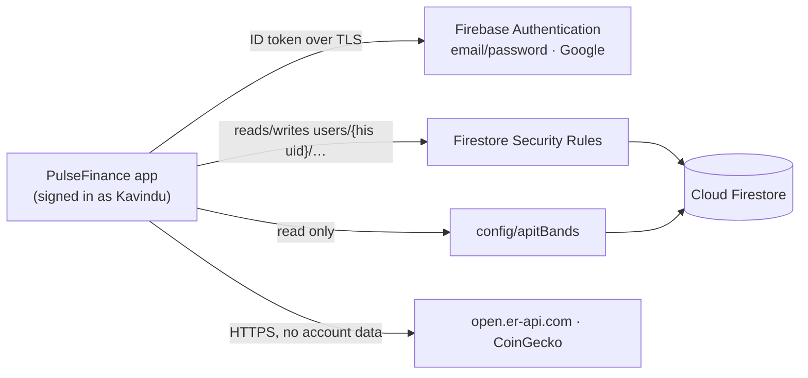

# Security, Permissions & External APIs

PulseFinance holds a picture of Kavindu's whole financial life: his salary, his freelance clients, his bank account numbers, what he spends on coffee. This document covers how that data is protected, what the app asks Android for, and which outside services it calls. It reflects the code on `main`, including the known gaps (§6).

---

## 1. Who can read his data



**Server-side rules** ([`firestore.rules`](../firestore.rules), NFR-5):

```javascript
match /users/{userId} {
  allow read, write: if request.auth != null && request.auth.uid == userId;
  match /accounts/{accountId}       { allow read, write: if request.auth != null && request.auth.uid == userId; }
  match /income_streams/{incomeId}  { allow read, write: if request.auth != null && request.auth.uid == userId; }
  match /expenses/{expenseId}       { allow read, write: if request.auth != null && request.auth.uid == userId; }
  match /goals/{goalId}             { allow read, write: if request.auth != null && request.auth.uid == userId; }
}
match /config/{docId} {
  allow read: if request.auth != null;
  allow write: if false;
}
```

What these rules guarantee:
- **Signed out:** no access to anything.
- **Signed in:** another user can never read or change `users/{Kavindu's uid}/…`.
- **Config:** `config/` is readable by any signed-in user and writable by nobody through the app. The APIT bands are edited in the Firebase console.
- **Everything else:** paths not listed are denied, because Firestore denies by default.

Deploy with `firebase deploy --only firestore:rules`.

---

## 2. Signing in

| Method | How | Req. |
|---|---|---|
| Email and password | Firebase Authentication | FR-AUTH-1 |
| Google | Android Credential Manager (`GetSignInWithGoogleOption`) with the project's web client ID, exchanged for a Firebase credential | FR-AUTH-2 |
| Demo account | Debug builds only. The demo drawer fills credentials from `BuildConfig.DEMO_EMAIL`/`DEMO_PASSWORD`; release builds set both to empty strings. The credentials are never written in documentation | FR-AUTH-7 |

Every screen gets its data through `whenSignedIn`. When he signs out, each flow switches to its signed-out value, so no screen keeps showing the previous user's records.

---

## 3. Sensitive data on the device

| Data | Protection | Req. |
|---|---|---|
| Bank account numbers (for freelance invoices) | Shown masked as `•••• 8472`. Revealing one requires `BiometricPrompt` with `BIOMETRIC_STRONG` or the device PIN/pattern | FR-ACC-6, NFR-10 |
| A copied account number | `BiometricHelper` clears the clipboard after 60 seconds | FR-ACC-7, NFR-10 |
| Card numbers, CVV | Never collected, stored or shown | C-13, C-14 |
| His balances on the dashboard | Can be hidden with the eye icon on the dashboard | — |
| Bank SMS | Never read. He shares an SMS into the app through the share sheet, and the parsed draft is shown for him to confirm | FR-EXP-7, NFR-12 |
| Local cache | Room database `pulse_finance_db` and the exchange-rate SharedPreferences, both in app-private internal storage | NFR-3 |

---

## 4. Android permissions

| Permission | Why | When |
|---|---|---|
| `INTERNET`, `ACCESS_NETWORK_STATE` | Firebase and exchange rates | Install time (normal permissions) |
| `PACKAGE_USAGE_STATS` | "Last opened" for Netflix or Spotify in Subscription Risk (FR-SUB-5) | Special access, granted by the user in Settings. **Not yet requested in context** (NFR-12 gap) |
| `READ_SMS` | Not requested; sharing replaces it | — |

The app also registers for `ACTION_SEND` with `text/plain`, so a bank SMS can be shared into it.

---

## 5. External APIs

| Service | Call | Data sent | Use | Limits |
|---|---|---|---|---|
| open.er-api.com | `GET /v6/latest/USD` | None | USD→LKR suggestion (FR-INC-5) | At most once a day (C-17), 4 s timeout |
| CoinGecko | `GET /api/v3/simple/price?ids=ethereum,tether&vs_currencies=usd` | None | USDT and ETH in USD | Same |
| Firebase Auth / Firestore | Firebase SDK | His records, under his UID | Sync and backup | Firestore offline cache |
| Google Drive API | Only from CI (`scripts/upload_to_gdrive.py`) | The release APK/AAB | Distributing builds to the team | Uses GitHub Actions secrets, never the app |

**How rates are used.** Rates are cached in SharedPreferences together with their fetch time, and the form shows the rate's age.
- **Offline, never fetched:** the app assumes USD→LKR 305.00, 1 USDT = 1 USD and 1 ETH = 2,600 USD, labelled "Offline benchmark".
- **Only a suggestion:** a fetched rate never overrides what his bank credited. The stored rate on each entry is never recomputed (ADR-0001).

**CSV export** (FR-DATA-1) goes through the Android share sheet (`ACTION_SEND`, `text/csv`), so he chooses where his data goes. The app never uploads it anywhere itself.

---

## 6. Known gaps

These are honest limitations of the current build, not features:

| Gap | Effect | Possible fix |
|---|---|---|
| `android:allowBackup="true"` | Android backup can include the Room cache and rate preferences | Set `allowBackup="false"`, or exclude `databases/` with backup rules |
| No `FLAG_SECURE` | Balances and revealed account numbers can appear in screenshots and the recent-apps preview | Set `FLAG_SECURE` on `MainActivity` |
| Sign-out does not delete the Room cache | The previous user's cached rows stay on the device. Queries filter by `userId`, so another user never sees them | Clear the user's tables on sign-out |
| Debug demo credentials are in `app/build.gradle.kts` | Anyone with repo access can read them; the repo is private | Read them from `local.properties` instead |
| Usage access is not requested in context | FR-SUB-5 only works if he finds the setting himself | Explain and request from the subscription audit (NFR-12) |
| Room is not encrypted | The cache is protected only by the app sandbox | SQLCipher, if the threat model requires it |
