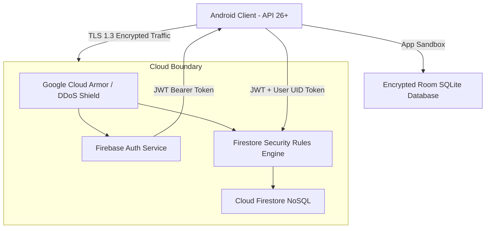

# Security, Rules & API Integration Specification

## 1. Security Architecture & Threat Model

PulseFinance enforces strict zero-trust security controls across all architectural tiers to safeguard sensitive financial data.



---

## 2. Cloud Firestore Security Rules

To prevent unauthorized cross-tenant data exposure, PulseFinance implements user-scoped rules deployed via [firestore.rules](file:///Users/hesaraperera/Desktop/PulseFinance/firestore.rules):

```javascript
rules_version = '2';
service cloud.firestore {
  match /databases/{database}/documents {

    // Helper functions
    function isAuthenticated() {
      return request.auth != null;
    }
    
    function isOwner(userId) {
      return isAuthenticated() && request.auth.uid == userId;
    }

    // User-isolated documents
    match /users/{userId} {
      allow read, write: if isOwner(userId);

      match /accounts/{accountId} {
        allow read, write: if isOwner(userId);
      }

      match /expenses/{expenseId} {
        allow read, write: if isOwner(userId);
      }

      match /income_streams/{incomeId} {
        allow read, write: if isOwner(userId);
      }

      match /goals/{goalId} {
        allow read, write: if isOwner(userId);
      }
    }

    // Default deny for all other paths
    match /{document=**} {
      allow read, write: if false;
    }
  }
}
```

### Security Rule Guarantees
1. **Zero Anonymous Access**: Unauthenticated requests are rejected at the edge.
2. **Strict User Scoping**: A user authenticated with `UID_A` can never query or manipulate documents under `/users/UID_B/`.
3. **No Global Wildcard Reads**: Prevents mass data scraping or directory enumeration.

---

## 3. Client-Side Security & Privacy Controls

1. **Android Application Sandbox**:
   - The local SQLite database file `pulse_finance.db` is stored strictly inside internal app storage (`/data/user/0/com.se3092.pulsefinance/databases/`), protected by Linux file permissions (`0600`).
2. **Preventing Memory Leaks**:
   - Sensitive financial calculations and credentials are held in short-lived ViewModel states cleared when activities terminate.
3. **Screenshot & Screen Recording Protection**:
   - In production release builds, `WindowManager.LayoutParams.FLAG_SECURE` can be enabled on `MainActivity` to prevent unauthorized screen captures of account balances in untrusted environments.

---

## 4. Currency Conversion Engine

PulseFinance implements a deterministic exchange converter in `ConvertCurrencyUseCase.kt` providing reliable currency calculations even without active internet connectivity:

```kotlin
class ConvertCurrencyUseCase @Inject constructor() {
    private val ratesToLkr = mapOf(
        CurrencyType.LKR to 1.0,
        CurrencyType.USD to 308.50,
        CurrencyType.USDT to 307.40
    )

    fun toLkr(amount: Double, from: CurrencyType): Double {
        val rate = ratesToLkr[from] ?: 1.0
        return amount * rate
    }

    fun fromLkr(amountLkr: Double, to: CurrencyType): Double {
        val rate = ratesToLkr[to] ?: 1.0
        return if (rate > 0.0) amountLkr / rate else 0.0
    }
}
```

---

## 5. Deployment of Security Rules

To push the latest security rules directly to the connected Firebase project:
```bash
firebase deploy --only firestore:rules
```
