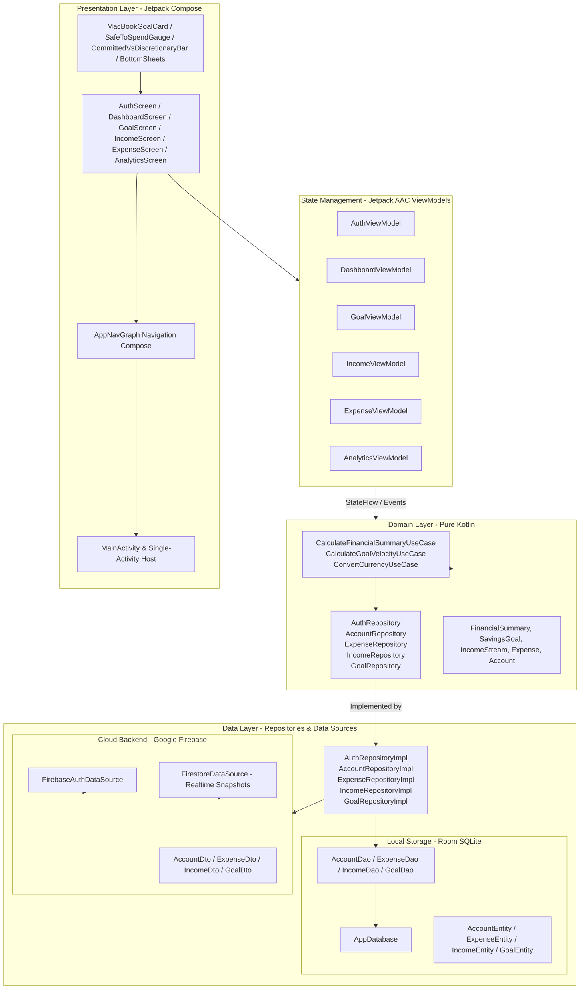

# System Architecture & Technical Design

## 1. Architectural Philosophy

PulseFinance is engineered on modern Android architectural guidelines recommended by Google and enterprise engineering standards:
1. **Clean Architecture with Strict Layer Separation**: Isolates Presentation, Domain (Business Logic), and Data layers.
2. **Unidirectional Data Flow (UDF)**: UI states flow downwards from ViewModels as immutable `StateFlow<T>`, while user intents and actions flow upwards as events.
3. **Offline-First Reactive Paradigm**: The local SQLite database (via Room) acts as the single source of truth for all query operations. Network writes (via Firebase Firestore) are synchronized asynchronously, ensuring zero UI latency and offline operation.
4. **Dependency Injection**: Powered by Google Dagger-Hilt to guarantee modularity, loose coupling, and painless mock-based testing.

---

## 2. High-Level Architecture Diagram



---

## 3. Layer Breakdown

### 3.1. Presentation Layer (`com.se3092.pulsefinance.ui`)
- **Single-Activity Architecture**: The application is hosted by [MainActivity.kt](file:///Users/hesaraperera/Desktop/PulseFinance/app/src/main/java/com/se3092/pulsefinance/MainActivity.kt), which delegates UI rendering to [AppNavGraph.kt](file:///Users/hesaraperera/Desktop/PulseFinance/app/src/main/java/com/se3092/pulsefinance/ui/navigation/AppNavGraph.kt).
- **Jetpack Compose (Material 3)**: Pure declarative UI without XML views. Dynamic animations, blur effects, canvas arc rendering (`SafeToSpendGauge`), and interactive drag/sliders are built with Compose runtime.
- **Navigation Compose**: Type-safe route definitions in [Screen.kt](file:///Users/hesaraperera/Desktop/PulseFinance/app/src/main/java/com/se3092/pulsefinance/ui/navigation/Screen.kt) supporting bottom navigation dock switching between Cockpit (`dashboard`), Income (`income`), Goals (`goal`), Analytics (`analytics`), and Expenses (`expense`).

### 3.2. ViewModel Layer
- Each feature module owns a lifecycle-aware ViewModel extending `androidx.lifecycle.ViewModel`.
- ViewModels expose an immutable `uiState: StateFlow<T>` collected in Compose using `collectAsStateWithLifecycle()`.
- Coroutine execution is bound to `viewModelScope`, ensuring structured concurrency and auto-cancellation when Composables leave composition.

### 3.3. Domain Layer (`com.se3092.pulsefinance.domain`)
- **Zero Android Framework Dependencies**: Written strictly in standard Kotlin for portability and isolated unit testing.
- **Repository Contracts**: Abstract interfaces defining business operations:
  - [IncomeRepository.kt](file:///Users/hesaraperera/Desktop/PulseFinance/app/src/main/java/com/se3092/pulsefinance/domain/repository/IncomeRepository.kt)
  - [GoalRepository.kt](file:///Users/hesaraperera/Desktop/PulseFinance/app/src/main/java/com/se3092/pulsefinance/domain/repository/GoalRepository.kt)
  - [ExpenseRepository.kt](file:///Users/hesaraperera/Desktop/PulseFinance/app/src/main/java/com/se3092/pulsefinance/domain/repository/ExpenseRepository.kt)
  - [AccountRepository.kt](file:///Users/hesaraperera/Desktop/PulseFinance/app/src/main/java/com/se3092/pulsefinance/domain/repository/AccountRepository.kt)
  - [AuthRepository.kt](file:///Users/hesaraperera/Desktop/PulseFinance/app/src/main/java/com/se3092/pulsefinance/domain/repository/AuthRepository.kt)
- **Use Cases (Interactors)**:
  - `CalculateFinancialSummaryUseCase`: Computes real-time totals, committed ratios, safe-to-spend allowances, and net savings.
  - `CalculateGoalVelocityUseCase`: Evaluates daily pacing targets, projected completion dates, and dynamic opportunity cost equations.
  - `ConvertCurrencyUseCase`: Handles normalized exchange conversions between USD/USDT and LKR.

### 3.4. Data Layer (`com.se3092.pulsefinance.data`)
- **Dual-Layer Repository Pattern**:
  - Repositories inject both Room DAOs (`local`) and Firebase Data Sources (`remote`).
  - Read queries return `Flow<List<DomainModel>>` directly from Room SQLite with automatic updates when records change.
  - Write queries insert/update locally first, then fire remote synchronization tasks to Cloud Firestore.

---

## 4. Offline-First Sync Lifecycle

```mermaid
sequenceDiagram
    autonumber
    actor User
    participant UI as Jetpack Compose UI
    participant VM as Feature ViewModel
    participant Repo as RepositoryImpl
    participant Local as Room DAO (SQLite)
    participant Remote as Firebase Firestore

    User->>UI: Logs expense / Edits goal allocation
    UI->>VM: Trigger Intent (e.g. addExpense())
    VM->>Repo: repository.addExpense(expense)
    Repo->>Local: dao.insertExpense(expenseEntity)
    Local-->>UI: Reactive Flow emits updated list immediately (0ms UI lag)
    
    rect rgb(20, 30, 45)
    Note over Repo,Remote: Asynchronous Cloud Synchronization
    Repo->>Remote: firestoreDataSource.syncExpense(dto)
    alt Sync Succeeded
        Remote-->>Repo: Document Written (ACK)
        Repo->>Local: Mark entity as synced = true
    else Network Offline
        Remote--xRepo: Network Unavailable
        Note over Repo,Local: Remains pending in Room; auto-retried on reconnect
    end
    end
```

---

## 5. Dependency Injection Graph (Hilt)

The application uses Google Dagger-Hilt for automated compile-time dependency injection across 3 primary modules:

1. **`DatabaseModule`**:
   - Provides singleton `AppDatabase` via `Room.databaseBuilder()`.
   - Binds `AccountDao`, `ExpenseDao`, `IncomeDao`, and `GoalDao`.
2. **`FirebaseModule`**:
   - Provides singleton instances of `FirebaseAuth` and `FirebaseFirestore`.
   - Injects `FirebaseAuthDataSource` and `FirestoreDataSource`.
3. **`RepositoryModule`**:
   - Binds domain repository interfaces to concrete implementations:
     - `AuthRepository` $\to$ `AuthRepositoryImpl`
     - `AccountRepository` $\to$ `AccountRepositoryImpl`
     - `ExpenseRepository` $\to$ `ExpenseRepositoryImpl`
     - `IncomeRepository` $\to$ `IncomeRepositoryImpl`
     - `GoalRepository` $\to$ `GoalRepositoryImpl`

---

## 6. Concurrency & Threading

- **UI Thread (Main)**: Reserved purely for Compose rendering and state observation.
- **Background Thread (`Dispatchers.IO`)**: Utilized by Room database queries, Firebase network requests, and cryptographic operations.
- **Computation Thread (`Dispatchers.Default`)**: Executed for mathematical aggregations, opportunity cost computations, and currency conversions.
