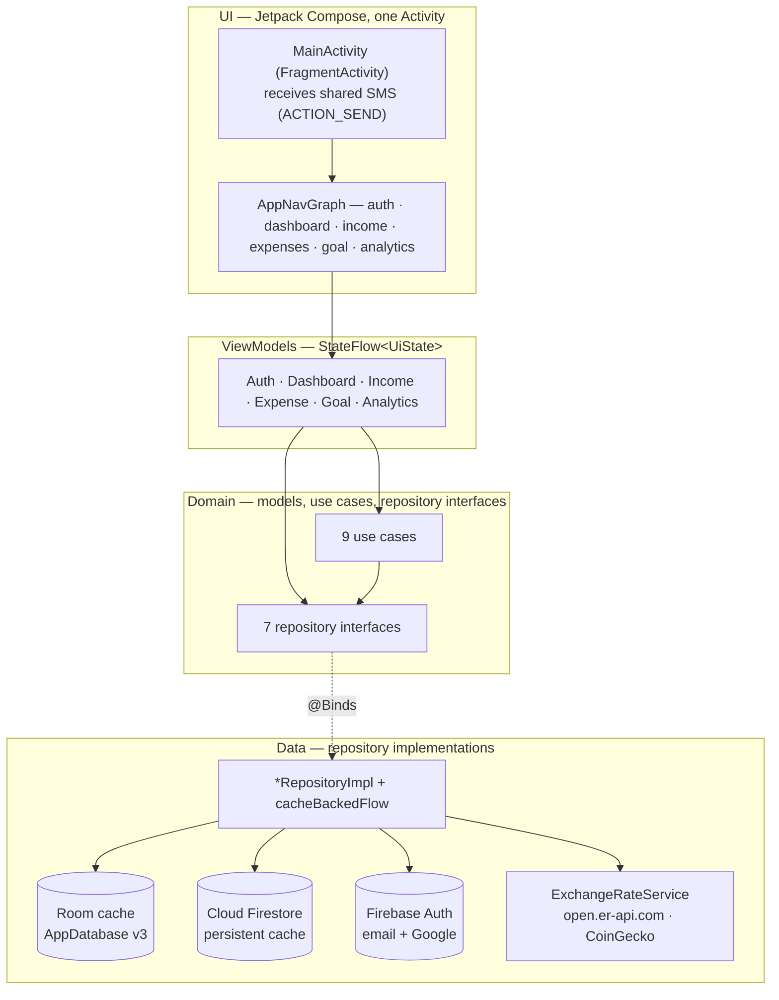
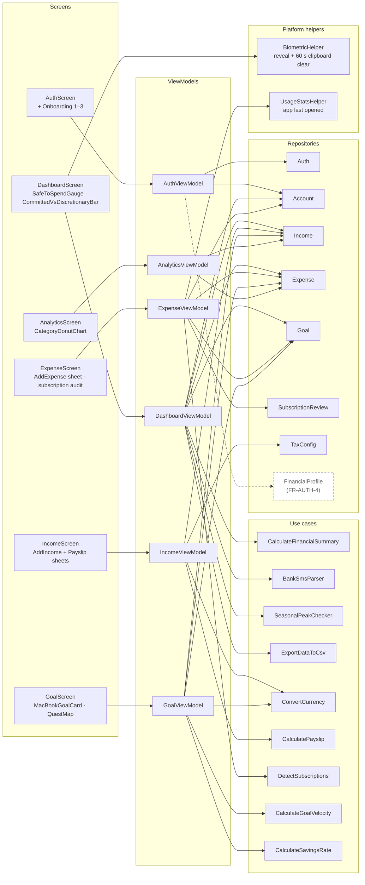
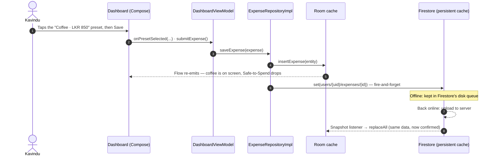

# System Architecture

PulseFinance is a single-activity Android app (Kotlin, Jetpack Compose, MVVM, Hilt, Room, Firebase). Each architectural choice below answers something in **Kavindu Silva's** scenario. Problem IDs (P1–P11) and requirement IDs refer to [SRS.md](SRS.md); the data itself is described in [DATA_MODELS_AND_STORAGE.md](DATA_MODELS_AND_STORAGE.md).

Everything here reflects the code on `main`. Dashed items in the diagrams are not built yet.

---

## 1. Why it is shaped this way

| Scenario fact | Architectural answer |
|---|---|
| He abandoned a Google Sheet after 13 days because entry was slow (P9). Logging has to work in a PickMe with no signal. | **Offline-first reads.** Every screen reads from a Room cache. Writes go to Room and Firestore's persistent queue at the same time, so a LKR 850 coffee appears instantly and syncs later (NFR-1, NFR-3). |
| He uses more than one device and expects the same numbers on each. | **Firestore is the source of truth.** Snapshot listeners mirror it into Room while a screen is open, so changes show up without a refresh (NFR-4). |
| His income arrives in LKR, USD (AdSense) and USDT/ETH (crypto), and past months must match his bank (P1, P3, P4). | **Rates are frozen per entry** (ADR-0001). The rate service only *suggests* a rate; the stored LKR amount never changes afterwards. |
| He can't tell committed from discretionary spending, or what he must save for the MacBook (P7, P8). | **Calculations live in domain use cases**, not in screens. The Safe-to-Spend Allowance, goal pace and savings rate are plain Kotlin functions with unit tests. |
| He shares bank SMS, needs his account number for invoices, and forgets subscriptions (P2, P5, P6). | **Platform features sit at the edges:** the share sheet (no READ_SMS permission), BiometricPrompt and Android usage stats, each behind a small helper. |

---

## 2. High-level layers

**Dependency direction:** UI → ViewModel → domain ← data. Screens hold no business logic; they collect `uiState` and call ViewModel functions.

**One honest exception:** the domain layer is not entirely free of Android code.
- `ExportDataToCsvUseCase` builds an Android share `Intent`.
- `ConvertCurrencyUseCase` wraps the data-layer `ExchangeRateService`.

Everything else in `domain/` is plain Kotlin and is unit-tested on the JVM.

---

## 3. Screens → ViewModels → use cases → repositories

Every ViewModel also uses `AuthRepository` to get the signed-in user's ID; only `AuthViewModel`'s link is drawn.

| Screen | What Kavindu does there | ViewModel uses | Solves |
|---|---|---|---|
| Auth + Onboarding | Signs in with email or Google; in debug builds a demo drawer fills the demo account | `AuthRepository`, `AccountRepository` (creates his four default accounts) | FR-AUTH-1, 2, 7 |
| Dashboard | Sees today's Safe-to-Spend, the overdue "Milestone 2" banner, the committed/discretionary bar, the Seasonal Peak warning; shares a bank SMS; exports CSV | `CalculateFinancialSummary`, `BankSmsParser`, `SeasonalPeakChecker`, `ExportDataToCsv`; Account, Income, Expense, Goal | P1, P2, P5, P7, P11 |
| Income | Logs salary from a payslip (EPF, APIT), AdSense in USD at the credited LKR, freelance invoices, crypto profit or loss | `ConvertCurrency`, `CalculatePayslip`; Income, TaxConfig | P1, P2, P3, P4, P10 |
| Expenses | Logs a PickMe in ≤ 3 taps, reviews detected subscriptions, gets a reminder when spending from a frozen account | `DetectSubscriptions`; Expense, Goal, Account, SubscriptionReview; `UsageStatsHelper` | P5, P6, P11 |
| Goal | Sees the required LKR 1,330/day pace for the MacBook, his actual savings rate, "days of MacBook" for each habit | `CalculateGoalVelocity`, `CalculateSavingsRate`, `ConvertCurrency`; Goal, Income, Expense | P8 |
| Analytics | Week/month/day/year donut and daily bars ("LKR 24,000 on coffee"), searchable ledger | Income, Expense | P7 |

---

## 4. Data flow: reads, writes and sync

### 4.1 Reads: `cacheBackedFlow`

`Account`, `Expense`, `Income` and `Goal` repositories return a `cacheBackedFlow`:

1. The UI collects a Room `Flow`, so it gets cached data immediately, online or not.
2. While someone is collecting, a Firestore snapshot listener runs alongside. Each snapshot is written to Room with `replaceAll` in a transaction, and Room's `Flow` re-emits.
3. When the screen goes away, the listener is removed with it.
4. If the listener fails (no network, permission), the cache keeps being served.

`GoalRepository` also combines the goal with `ExchangeRateService.usdLkrRate`, so a USD-linked MacBook target re-prices when the day's rate arrives (FR-GOAL-6).

`SubscriptionReviewRepository` and `TaxConfigRepository` skip Room and rely on Firestore's own offline cache: one small map and one config document.

### 4.2 Writes: Kavindu logs a coffee with no signal

Writes don't wait for the server. Awaiting the Firestore task would hang until the device reconnects, so the call just logs a failure if one comes back. There is no "synced" flag; Firestore's queue is what guarantees the upload.

### 4.3 Money in: his AdSense payout

1. The add-income sheet pre-fills the day's USD→LKR rate from `ExchangeRateService` (cached in SharedPreferences, refreshed at most once a day).
2. He enters USD 45 and the LKR 13,612.50 his bank actually credited.
3. The app stores rate 302.5 and `amountInLkr` 13,612.50. Neither is ever recomputed (ADR-0001), so October still matches his bank statement in March.

---

## 5. Platform integrations

| Feature | Where | How |
|---|---|---|
| Share a bank SMS into the app (FR-EXP-7) | `MainActivity` → `AppNavGraph` → `DashboardViewModel.handleSharedBankSms` → `BankSmsParser` | Android share sheet (`ACTION_SEND`, `text/plain`). No `READ_SMS` permission. |
| Reveal and copy his account number for a freelance invoice (FR-ACC-6, 7) | `BiometricHelper`, `DashboardScreen` | `BiometricPrompt` (biometric or device PIN); the clipboard is cleared after 60 seconds |
| "Last opened" for Netflix and Spotify (FR-SUB-5) | `UsageStatsHelper`, `ExpenseViewModel` | `UsageStatsManager`; only works if usage access is granted (in-context prompt not built yet, NFR-12) |
| Daily rates (FR-INC-5) | `ExchangeRateService` | `HttpURLConnection` on `Dispatchers.IO`, 4 s timeouts, at most once a day |
| CSV export (FR-DATA-1) | `ExportDataToCsvUseCase` | Builds a CSV and an `ACTION_SEND` share intent |
| APIT bands (FR-LK-2) | `TaxConfigRepositoryImpl` | Firestore `config/apitBands`, validated; falls back to bundled bands |

---

## 6. Dependency injection (Hilt)

| Module | Provides |
|---|---|
| `DatabaseModule` | `AppDatabase` (Room, `fallbackToDestructiveMigration`) and the four DAOs |
| `FirebaseModule` | `FirebaseAuth`; `FirebaseFirestore` with `PersistentCacheSettings` (the offline write queue) |
| `RepositoryModule` | `@Binds` for `Auth`, `Expense`, `Income`, `Goal`, `Account`, `SubscriptionReview` and `TaxConfig` repositories |

Data sources (`FirebaseAuthDataSource`, `FirestoreDataSource`, `ExchangeRateService`) and use cases use constructor `@Inject`. ViewModels are `@HiltViewModel` and obtained with `hiltViewModel()` in `AppNavGraph`.

---

## 7. Threading

- **ViewModels:** combine repository flows and expose `StateFlow` via `stateIn(viewModelScope, WhileSubscribed(5000))`. When he leaves a screen for more than 5 seconds, its Firestore listeners stop.
- **Room:** DAO `suspend` functions and `Flow` queries run on Room's own background executor.
- **Firestore:** listener callbacks arrive on the main thread and are adapted to `Flow` with `callbackFlow`.
- **Network:** rate fetches run on `Dispatchers.IO`.
- **Use cases:** pure functions over lists, small enough to run on the collecting coroutine.
