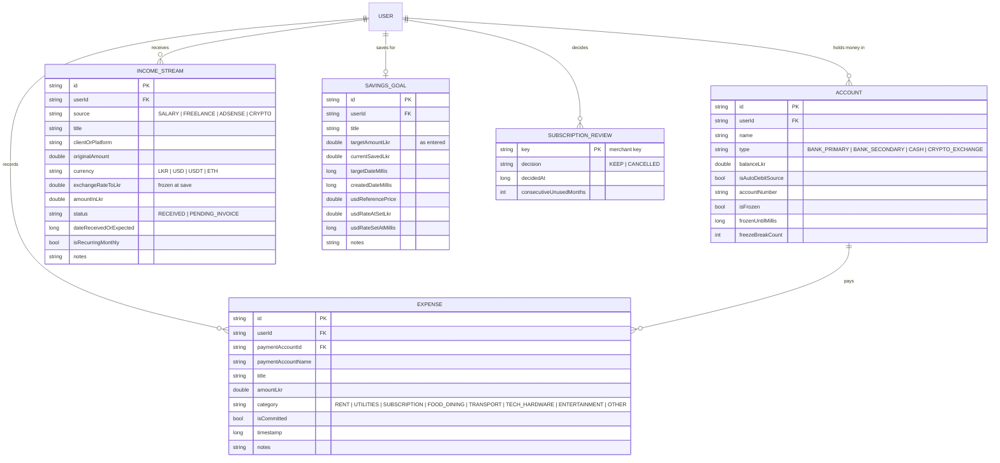

# Data Models, Firestore Schema & Storage

This is the data PulseFinance keeps for **Kavindu Silva**: the money that arrives (salary, freelance milestones, AdSense in USD, crypto results), the money that leaves (rent, PickMe, coffee, two forgotten subscriptions on his secondary account), and the one goal it all feeds (a MacBook Pro M4, about LKR 490,000).

Every collection and field below is taken from the code on `main`. Problem IDs (P1–P11) and requirement IDs (FR-…, NFR-…) refer to [SRS.md](SRS.md).

---

## 1. Where data lives

| Store | What it holds | Why |
|---|---|---|
| **Cloud Firestore** (`users/{uid}/…`) | The source of truth for everything he records | The same records appear on any device he signs in on (FR-AUTH-3). Firestore's persistent disk cache queues writes made offline and replays them on reconnect (FR-EXP-6, NFR-3). |
| **Room** (`AppDatabase`, version 3) | A local cache of accounts, expenses, income and goals | Screens read only from Room, so they open instantly and work with no signal. While a screen is open, a Firestore listener mirrors changes into Room (`cacheBackedFlow`), which is what makes the dashboard update in real time (NFR-4). |
| **Firestore `config/`** | App-wide settings that are not his data: the APIT tax bands | A budget revision changes the tax bands; editing a document is faster than shipping an app update (FR-LK-2). |
| **SharedPreferences** (`pulse_exchange_rates`) | The day's USD→LKR, USDT→USD and ETH→USD rates | Fetched at most once a day from open.er-api.com and CoinGecko, and usable offline with their age shown (FR-INC-5, C-17). |

Room is **only a cache**. It uses `fallbackToDestructiveMigration()`, so a schema change wipes it and it is rebuilt from Firestore on the next sync. Pending offline writes are not lost when that happens, because they are queued in Firestore's own cache, not in Room.

---

## 2. Firestore schema

```
users/
  └── {uid}                              user document
        │   subscriptionReviews: map     Keep/Cancel decisions, keyed by merchant (FR-SUB-3, FR-SUB-4)
        │
        ├── accounts/{accountId}         AccountDto      where money is held or paid from (P5)
        ├── expenses/{expenseId}         ExpenseDto      money out (P5, P6, P7)
        ├── income_streams/{incomeId}    IncomeDto       money in, received or invoiced (P1–P4)
        └── goals/{goalId}               GoalDto         the MacBook goal (P8)

config/                                  read-only for signed-in users
  └── apitBands                          ApitConfigDto   APIT tax schedule (FR-LK-2)
```

There is no `profile` subcollection. Small per-user settings live as fields on the user document itself, written with a merge so they never overwrite each other:

| Field on `users/{uid}` | Holds | Written by |
|---|---|---|
| `subscriptionReviews.<key>` | Keep / Cancel decision per detected subscription | Subscription audit (FR-SUB-3) |
| `seasonalReserves.<peakKey>` | `amountLkr`, `setAsideAt`, `peakDateMillis` for each "Set aside" | Seasonal Peak warning (FR-LK-5) |
| `onboarding` | `monthlySalaryLkr`, `incomeSources` (source → `LOW` / `MODERATE` / `VOLATILE`), `fixedCommitments`, `completedAt` | First-run setup (FR-AUTH-4, 5) |

### 2.1 `users/{uid}/accounts/{accountId}`: `AccountDto`

On first sign-in, `ensureDefaultAccounts` creates one zero-balance account per place Kavindu's money leaves from, so every expense can be attributed from the first entry. It checks the server first, so an empty offline cache is never mistaken for a new user.

| Field | Type | Kavindu example | Notes |
|---|---|---|---|
| `id` | string (document ID) | `acc_secondary_bank` | Fixed IDs for the four default accounts |
| `userId` | string | his Firebase UID | |
| `name` | string | `Secondary Account (Auto-Debits)` | |
| `type` | string | `BANK_SECONDARY` | `BANK_PRIMARY` · `BANK_SECONDARY` · `CASH` · `CRYPTO_EXCHANGE` (FR-ACC-1) |
| `balanceLkr` | number | `0` | Starts at zero; nothing is pre-filled |
| `isAutoDebitSource` | boolean | `true` | The account his gym and the forgotten subscriptions are charged to (P6, FR-SUB-6) |
| `accountNumber` | string | `1002938472` | Shown masked (`•••• 8472`) until a biometric check (FR-ACC-6) |
| `isFrozen` | boolean | `false` | Spending Freeze (FR-ACC-3) |
| `frozenUntilMillis` | number \| null | `null` | When the freeze ends |
| `freezeBreakCount` | number | `0` | Times he logged an expense on a frozen account (FR-ACC-5) |

### 2.2 `users/{uid}/expenses/{expenseId}`: `ExpenseDto`

| Field | Type | Kavindu example | Notes |
|---|---|---|---|
| `id` | string (document ID) | UUID | |
| `userId` | string | his UID | |
| `title` | string | `PickMe to office` | Also the merchant key for subscription detection |
| `amountLkr` | number | `1450` | Always LKR |
| `category` | string | `TRANSPORT` | `RENT` · `UTILITIES` · `SUBSCRIPTION` · `FOOD_DINING` · `TRANSPORT` · `TECH_HARDWARE` · `ENTERTAINMENT` · `OTHER` |
| `isCommitted` | boolean | `false` | Proposed from the category (Rent → committed, Food & Dining → discretionary); he can flip it per expense (FR-EXP-2, P7) |
| `paymentAccountId` | string | `acc_cash` | Covers cash and the secondary account, not just his card (FR-EXP-5) |
| `paymentAccountName` | string | `Cash in Hand` | Copied so the list renders without a join |
| `timestamp` | number (ms) | | |
| `notes` | string | | |

A Netflix charge is an expense with `category = SUBSCRIPTION`. `DetectSubscriptionsUseCase` groups those by merchant over the last 120 days. That is how the two subscriptions he meant to cancel six months ago resurface (FR-SUB-1).

### 2.3 `users/{uid}/income_streams/{incomeId}`: `IncomeDto`

| Field | Type | Kavindu example (AdSense) | Notes |
|---|---|---|---|
| `id` | string (document ID) | UUID | |
| `userId` | string | his UID | |
| `source` | string | `ADSENSE` | `SALARY` · `FREELANCE` · `ADSENSE` · `CRYPTO` |
| `title` | string | `AdSense – October` | |
| `clientOrPlatform` | string | `Google AdSense` | For freelance, the SME client he invoices (P2) |
| `originalAmount` | number | `45` | In the original currency. Negative for a crypto loss (FR-INC-7) |
| `currency` | string | `USD` | `LKR` · `USD` · `USDT` · `ETH` |
| `exchangeRateToLkr` | number | `302.5` | **Frozen at save time** (ADR-0001). Derived from what his bank actually credited, if he entered that (FR-INC-6) |
| `amountInLkr` | number | `13612.5` | `originalAmount × exchangeRateToLkr`, stored, so past months still reconcile with his bank statement (NFR-6) |
| `status` | string | `RECEIVED` | `RECEIVED` or `PENDING_INVOICE` |
| `dateReceivedOrExpected` | number (ms) | | The due date while pending |
| `isRecurringMonthly` | boolean | `false` | `true` for his salary |
| `notes` | string | | |

`OVERDUE` is never stored. A `PENDING_INVOICE` whose date has passed is reported as overdue by `IncomeStream.effectiveStatus()`, so his "Milestone 2" invoice turns overdue without anyone relabelling it (FR-INC-4).

### 2.4 `users/{uid}/goals/{goalId}`: `GoalDto`

| Field | Type | Kavindu example | Notes |
|---|---|---|---|
| `id` | string (document ID) | UUID | The earliest-created goal is his primary goal |
| `userId` | string | his UID | |
| `title` | string | `MacBook Pro M4` | |
| `targetAmountLkr` | number | `490000` | The target **as he entered it**, never the rate-adjusted value, so it is never scaled twice |
| `currentSavedLkr` | number | `11200` | Never changed by exchange-rate moves |
| `targetDateMillis` | number (ms) | 12 months out | |
| `createdDateMillis` | number (ms) | | |
| `notes` | string | | |
| `usdReferencePrice` | number \| null | `1599` | Apple's USD price (FR-GOAL-6) |
| `usdRateAtSetLkr` | number \| null | `300.0` | USD→LKR when the target was set |
| `usdRateSetAtMillis` | number \| null | | When it was set |

When the goal is USD-linked, the app shows `targetAmountLkr × today's rate ÷ usdRateAtSetLkr`. If the rupee weakens from 300 to 306, his target becomes LKR 499,800, and the goal card says "Target + LKR 9,800 since …". The reseller's markup is kept.

### 2.5 `users/{uid}`: `subscriptionReviews` map

Stored as one map field on the user document, written with `SetOptions.merge()`:

```json
{
  "subscriptionReviews": {
    "netflix_premium": { "decision": "CANCELLED", "decidedAt": 1730700000000, "consecutiveUnusedMonths": 0 },
    "gym_membership":  { "decision": "KEEP",      "decidedAt": 1730600000000, "consecutiveUnusedMonths": 2 }
  }
}
```

- **Key:** the merchant title lower-cased, with non-alphanumerics replaced by `_` (`DetectSubscriptionsUseCase.keyFor`).
- **`CANCELLED` + a later charge:** flags the subscription as "still charging" (FR-SUB-3).
- **`consecutiveUnusedMonths`:** counts "Did you use this?" answers of No. At 2, Subscription Risk becomes High (FR-SUB-4).

### 2.6 `config/apitBands`: `ApitConfigDto`

The payslip calculator reads its APIT schedule from here (FR-LK-2).
- Bands must start at 0 and be contiguous, with rates between 0 and 1. `upperLkr: null` marks the top band.
- If the document is missing or invalid, the app uses `ApitTaxBand.DEFAULTS`.
- Offline, Firestore's cache serves the last schedule read.

```json
{
  "effectiveFrom": "2025-04-01",
  "bands": [
    { "lowerLkr": 0,      "upperLkr": 100000, "rate": 0.00 },
    { "lowerLkr": 100000, "upperLkr": 141667, "rate": 0.06 },
    { "lowerLkr": 141667, "upperLkr": 183333, "rate": 0.12 },
    { "lowerLkr": 183333, "upperLkr": 225000, "rate": 0.18 },
    { "lowerLkr": 225000, "upperLkr": 266667, "rate": 0.24 },
    { "lowerLkr": 266667, "upperLkr": 308333, "rate": 0.30 },
    { "lowerLkr": 308333, "upperLkr": null,   "rate": 0.36 }
  ]
}
```

On a LKR 140,000 gross salary this gives APIT of LKR 2,400 and employee EPF of LKR 11,200 (8%). That leaves a take-home of LKR 126,400, the figure Kavindu could not recall from his payslip (P10).

To change the schedule, edit the document in the Firebase console (Firestore → `config` → `apitBands`).

### 2.7 Security rules

From [`firestore.rules`](../firestore.rules), enforced server-side (NFR-5):

| Path | Read | Write |
|---|---|---|
| `users/{uid}` and every subcollection above | only that signed-in user | only that signed-in user |
| `config/{doc}` | any signed-in user | nobody from the app (console only) |

Deploy with `firebase deploy --only firestore:rules`.

---

## 3. Entity-relationship model



`SUBSCRIPTION_REVIEW` is a map entry on the user document, not a collection. The app reads only one goal per user, the earliest created (`GoalDao.getPrimaryGoal`).

---

## 4. Room cache (`AppDatabase`)

```kotlin
@Database(
    entities = [ExpenseEntity::class, IncomeEntity::class, GoalEntity::class, AccountEntity::class],
    version = 3,
    exportSchema = false
)
```

| Table | Entity | DAO reads | DAO writes |
|---|---|---|---|
| `accounts` | `AccountEntity` | `getAccounts(userId)` | `insertAccount`, `replaceAll` |
| `expenses` | `ExpenseEntity` | `getExpenses(userId)`, newest first | `insertExpense`, `deleteExpense`, `replaceAll` |
| `income_streams` | `IncomeEntity` | `getIncomeStreams(userId)`, newest first | `insertIncome`, `updateStatus`, `deleteIncome`, `replaceAll` |
| `savings_goals` | `GoalEntity` | `getPrimaryGoal(userId)`, earliest created | `insertGoal`, `updateSavedAmount`, `replaceAll` |

- **Fields:** entity fields match the DTOs above one for one.
- **`replaceAll(userId, list)`:** runs in a transaction. The Firestore listener calls it with each snapshot, so the cache always equals the server's view.
- **Subscription reviews and tax bands:** not cached in Room. They are small and rely on Firestore's own offline cache.

---

## 5. Money, currencies and rates

1. **Everything is reported in LKR, and nothing is recomputed later.** Each income entry stores its original amount, its currency, the rate used and the LKR result. A later rate change never moves last month's totals, so they keep matching his bank (ADR-0001, NFR-6).
2. **The fetched rate is only a suggestion.** The form pre-fills the day's rate from open.er-api.com (USD→LKR) and CoinGecko (USDT, ETH). When his AdSense payout lands, he can type the LKR amount the bank actually credited, and the app stores the effective rate that implies (FR-INC-6). This is what fixes "never records what he actually receives" (P3).
3. **Offline fallback:** if no rate has ever been fetched, the app assumes USD→LKR 305.00, 1 USDT = 1 USD and 1 ETH = 2,600 USD, and labels the rate "Offline benchmark".
4. **The goal is the one value that follows the live rate**, and only when it has a USD reference price (§2.4).
