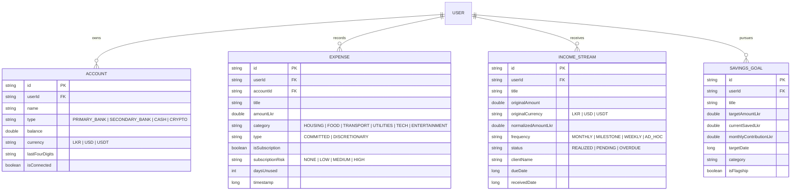

# Data Models, Schemas & Storage Architecture

## 1. Storage Architecture Overview

PulseFinance utilizes an offline-first hybrid storage model combining local SQLite persistence via **Android Jetpack Room** with cloud synchronization via **Google Cloud Firestore**:

- **Local Storage (Room Database)**: Provides instantaneous UI updates, zero network latency, and continuous offline availability.
- **Cloud Storage (Cloud Firestore)**: Provides multi-device synchronization, secure backup, and cross-session persistence.

---

## 2. Entity-Relationship Model



---

## 3. Local Room Database (`AppDatabase.kt`)

### 3.1. Database Configuration
```kotlin
@Database(
    entities = [
        AccountEntity::class,
        ExpenseEntity::class,
        IncomeEntity::class,
        GoalEntity::class
    ],
    version = 1,
    exportSchema = false
)
abstract class AppDatabase : RoomDatabase() {
    abstract fun accountDao(): AccountDao
    abstract fun expenseDao(): ExpenseDao
    abstract fun incomeDao(): IncomeDao
    abstract fun goalDao(): GoalDao
}
```

### 3.2. Data Access Objects (DAOs)

#### `AccountDao.kt`
- `getAllAccounts(userId: String): Flow<List<AccountEntity>>`: Emits live account list sorted by balance.
- `getAccountById(id: String): Flow<AccountEntity?>`: Retrieves specific account details.
- `insertAccount(account: AccountEntity)`: Inserts or updates account.
- `updateBalance(id: String, newBalance: Double)`: Atomic balance updates during transfers.

#### `ExpenseDao.kt`
- `getAllExpenses(userId: String): Flow<List<ExpenseEntity>>`: Stream of transactions ordered by `timestamp DESC`.
- `getSubscriptions(userId: String): Flow<List<ExpenseEntity>>`: Filters for recurring subscriptions.
- `getExpensesByDateRange(userId: String, from: Long, to: Long): Flow<List<ExpenseEntity>>`: Analytics aggregations.
- `insertExpense(expense: ExpenseEntity)`: Logs new debit record.
- `deleteExpense(id: String)`: Deletes or nukes a subscription.

#### `IncomeDao.kt`
- `getAllIncomeStreams(userId: String): Flow<List<IncomeEntity>>`: Stream of all active and pending income sources.
- `getOverdueInvoices(userId: String): Flow<List<IncomeEntity>>`: Filters streams where `status = 'OVERDUE'`.
- `updateIncomeStatus(id: String, status: String, receivedDate: Long)`: Reconciles pending invoice into cleared cash.

#### `GoalDao.kt`
- `getAllGoals(userId: String): Flow<List<GoalEntity>>`: Stream of active savings targets.
- `getFlagshipGoal(userId: String): Flow<GoalEntity?>`: Retrieves primary goal (MacBook Pro M4).
- `updateGoalProgress(id: String, newSaved: Double, monthlyContribution: Double)`: Recalculates velocity parameters.

---

## 4. Remote Cloud Firestore Schema

Data is partitioned hierarchically under each authenticated user UID to enforce security isolation:

```
users/
  └── {userId}/
        ├── profile/ (metadata, preferred currency, setup timestamp)
        ├── accounts/
        │     └── {accountId} (AccountDto)
        ├── expenses/
        │     └── {expenseId} (ExpenseDto)
        ├── income_streams/
        │     └── {incomeId} (IncomeDto)
        └── goals/
              └── {goalId} (GoalDto)

config/                      (read-only for signed-in users)
  └── apitBands (ApitConfigDto)
```

### 4.0. APIT tax bands: `config/apitBands`

The payslip calculator reads its APIT schedule from this document (FR-LK-2), so a budget revision only needs a console edit. Bands must start at 0 and be contiguous; `upperLkr: null` marks the top band. If the document is missing or invalid, the app uses the bands bundled in `ApitTaxBand.DEFAULTS`.

Create it in the Firebase console (Firestore → `config` → document ID `apitBands`):

```json
{
  "effectiveFrom": "2025-04-01",
  "bands": [
    { "lowerLkr": 0,      "upperLkr": 100000, "rate": 0.00 },
    { "lowerLkr": 100000, "upperLkr": 141667, "rate": 0.06 },
    { "lowerLkr": 141667, "upperLkr": 183333, "rate": 0.12 },
    { "lowerLkr": 183333, "upperLkr": 225000, "rate": 0.18 },
    { "lowerLkr": 225000, "upperLkr": 266667, "rate": 0.24 },
    { "lowerLkr": 266667, "upperLkr": 308333, "rate": 0.30 },
    { "lowerLkr": 308333, "upperLkr": null,   "rate": 0.36 }
  ]
}
```

Deploy the matching rule with `firebase deploy --only firestore:rules`.

### 4.1. Firestore DTO Example: `IncomeDto`
```kotlin
data class IncomeDto(
    val id: String = "",
    val userId: String = "",
    val title: String = "",
    val originalAmount: Double = 0.0,
    val originalCurrency: String = "LKR",
    val normalizedAmountLkr: Double = 0.0,
    val frequency: String = "MONTHLY",
    val status: String = "REALIZED",
    val clientName: String? = null,
    val dueDate: Long? = null,
    val receivedDate: Long? = null,
    val updatedAt: Long = System.currentTimeMillis()
)
```

---

## 5. Multi-Currency Normalization Mechanism

PulseFinance solves currency fragmentation across USD freelance contracts, Binance USDT staking, and local Sri Lankan Rupee accounts:

1. **Storage Integrity**: Both `originalAmount` (e.g., `$600.00 USD`) and `normalizedAmountLkr` (`LKR 185,000.00`) are stored simultaneously.
2. **Deterministic Exchange Rates**: Handled via `ConvertCurrencyUseCase`:
   - USD $\to$ LKR: $1.00\text{ USD} = 308.50\text{ LKR}$
   - USDT $\to$ LKR: $1.00\text{ USDT} = 307.40\text{ LKR}$
3. **UI Transparency**: Stream cards render the native currency badge alongside the normalized LKR equivalent to guarantee accurate mental accounting.
