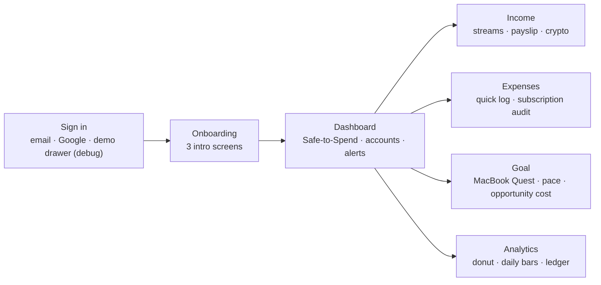

# Features Specification

This describes, screen by screen, what Kavindu Silva can do in PulseFinance **as built on `main`**. Each feature names the requirement it implements; the requirement text, priority and status live in [SRS.md](SRS.md). Features not yet built are marked **Not built** and listed in SRS §10.1.



---

## 1. Sign-in and onboarding

| Feature | How it works | Req. |
|---|---|---|
| Email sign-in and registration | Firebase Authentication. All his records are stored under his user ID, so they follow him to any device | FR-AUTH-1, 3 |
| Google sign-in | "Continue with Google" through Android Credential Manager | FR-AUTH-2 |
| Demo drawer | **Debug builds only.** "Auto Fill" enters a pre-seeded demo account. The credentials come from `BuildConfig` and are empty in release builds; they are deliberately not written in any document | FR-AUTH-7 |
| Default accounts | His first sign-in creates four empty accounts: Primary Bank, Secondary (Auto-Debits), Cash in Hand, Binance / Crypto Wallet. Nothing else is pre-filled | FR-ACC-1 |
| Onboarding | Three introduction screens before sign-in: "one clear picture", "track every income stream", "kill zombie leaks". They can be skipped | — |
| First-run setup | After a new account's first sign-in, three steps: his monthly take-home salary (optional); which sources he earns from, each rated Steady / Varies / Highly volatile; his fixed monthly commitments (Rent pre-filled, quick-add Gym, Internet, Phone, Electricity); then his **safety buffer**, 1 to 6 months of those costs to keep aside in case income stops (three is preselected, and the step shows what it comes to, e.g. LKR 116,400 for rent and broadband), plus an optional amount he has already set aside. Saved to `users/{uid}.onboarding`; each commitment is also logged as this month's committed expense so Safe-to-Spend is right from day one. Can be skipped | FR-AUTH-4, 5, 6 |

---

## 2. Dashboard

The first screen after sign-in. It answers his daily question: "how much can I spend today without hurting rent or the MacBook?"

**Safe to Spend Today (FR-DASH-1, 2, 3)**

```
Safe-to-Spend per day = (Income Basis − committed spent − goal saving this month − discretionary spent) ÷ days left in month
```

- **Income Basis:** this month's received income, or the average of the last three months if that is higher. The average is used early in the month, before his salary lands on the 25th.
- **Crypto in the average:** profits are left out and losses are kept, so one lucky trade cannot inflate the allowance.
- **Not counted:** pending and overdue invoices are never treated as spendable.
- **Floor:** the result never goes below zero.

| Feature | How it works | Req. |
|---|---|---|
| Committed vs discretionary bar | This month's split with amounts, e.g. rent LKR 34,000 and broadband LKR 4,800 on one side, coffee, PickMe and UberEats on the other | FR-DASH-4 |
| Overdue invoice banner | "*amount* is waiting for you", with the client name and one-tap **Mark received** | FR-DASH-5 |
| Live updates | Figures update from Firestore listeners, with no refresh | FR-DASH-6 |
| Accounts & Channels | His four accounts and their combined balance. The balance can be hidden with the eye icon | FR-ACC-2 |
| Spending Freeze | Freezes an account for 14 days; it then shows as locked. A purchase from a frozen account shows "will delay your savings goal by ~N days" and offers **Log anyway**. The app never refuses to record it, and the break is counted ("N Freeze Breaks") | FR-ACC-3, 4, 5 |
| Account number reveal | Account numbers show as `•••• 8472`. Revealing one needs `BiometricPrompt` (fingerprint or device PIN). Copying it for a freelance invoice clears the clipboard after 60 seconds. There is no card number or CVV anywhere in the app | FR-ACC-6, 7 |
| Seasonal Peak warning | 30 days before Avurudu (14 Apr), Vesak (15 May), Poson (15 Jun), December (25 Dec), or one of his own peak months: "Peak in N days · Set aside LKR X". The amount is last year's excess over his monthly average, or a default buffer (35k / 20k / 15k / 45k) when unknown. One tap on **Set aside** holds the amount back from Safe-to-Spend until the peak day (an earmark, not an expense), with **Undo** | FR-LK-4, 5 |
| Safety buffer | A card on Today: "3 months of your fixed costs · LKR 116,400", a progress bar and how many months what he has set aside covers ("LKR 58,200 set aside · covers 1.5 of 3 months"). He can change the number of months (1 to 6) and add LKR 5,000 / 10,000 / 25,000 as he sets money aside. The size uses his fixed costs from setup as a floor and grows if he logs more committed spending. The amount is his own tally, not a transaction, and it does not change Safe-to-Spend. Until he picks a number of months (an account set up before this existed, or setup skipped) the card asks him to | FR-AUTH-6 |
| Quick log | "Log it in one tap": presets from his own most-repeated spends in the last 60 days, each with its latest amount, topped up with starter shortcuts (Coffee, PickMe ride, UberEats, Dialog Reload, Mobitel Data Package, Fiber Broadband, Rent) that fill in the title, icon and category but leave the amount for him to enter | FR-EXP-3, 4, NFR-1 |
| Share a bank SMS | Sharing a bank SMS to PulseFinance (Commercial Bank, Sampath, HNB, Nations Trust formats) opens a draft expense with the amount, merchant and card last four digits filled in. Uses the share sheet; the app never asks for READ_SMS | FR-EXP-7 |
| CSV export | Exports income, expenses and goals as CSV through the Android share sheet | FR-DATA-1 |
| Empty state | A new user sees "Get your first clear picture" with what to do next, never a blank or zero screen | NFR-9 |

---

## 3. Income hub

| Feature | How it works | Req. |
|---|---|---|
| Record income | Source (Salary, Freelance, AdSense, Crypto), title, client or platform, amount, currency (LKR, USD, USDT, ETH), date. Status is received or invoiced | FR-INC-1 |
| Day's rate as a suggestion | The form pre-fills the day's rate (open.er-api.com, CoinGecko), cached once a day and labelled with its age | FR-INC-5 |
| What the bank actually credited | For his AdSense payout he can type the LKR amount that arrived instead of a rate; the form shows "Effective rate: …". The rate is frozen on save and never recomputed | FR-INC-2, 6, ADR-0001 |
| Pending and overdue invoices | A freelance milestone is saved as invoiced with a due date. It becomes overdue automatically once the date passes, and **Mark received** moves it to received | FR-INC-3, 4 |
| Received vs unpaid | "*n*% collected" bar for the month, and "This month by source" totals | FR-INC-9 |
| Crypto | Profit or loss per trade (a loss is negative). "Crypto net, year to date" | FR-INC-7, 8 |
| Payslip | Gross salary → employee EPF 8%, APIT from the Firestore tax bands, other deductions, take-home pay; all editable. On LKR 140,000 gross: APIT LKR 2,400, EPF LKR 11,200, take-home LKR 126,400 | FR-LK-1, 2 |
| EPF balance | "Accumulated EPF Wealth": employee 8% + employer 12%, shown as savings he already owns | FR-LK-3 |

---

## 4. Expenses and subscription audit

| Feature | How it works | Req. |
|---|---|---|
| Add expense | Amount in LKR, category, committed/discretionary (proposed by the category; one tap to flip), paying account (including Cash and the secondary account), note. Offline entries appear immediately and sync later | FR-EXP-1, 2, 5, 6 |
| Detected subscriptions | Subscription-category expenses grouped by merchant over 120 days. Each shows its monthly and annual cost ("LKR X / yr") and the account it is charged to | FR-SUB-1, 2 |
| Secondary account highlight | Subscriptions on the auto-debit account are grouped under "⚡ Secondary Account (Auto-Debit)", where his forgotten gym and two subscriptions sit | FR-SUB-6 |
| Keep or cancel | "I cancelled it" records the decision. A charge logged after a cancel marks the subscription as still charging | FR-SUB-3 |
| "Did you use this this month?" | Yes / No after a charge. Two No answers in a row: "Unused for 2 consecutive months! Cancellation recommended." | FR-SUB-4 |
| Risk | **High:** still charging after a cancel, 2+ unused months, or the app not opened for 30+ days. **Medium:** 1 unused month, 14–29 days unopened, or not yet reviewed. **Low:** otherwise | FR-SUB-4, 5 |
| App last opened | For Netflix, Spotify and similar, the last-opened date from Android usage stats feeds the risk. Only works if usage access is granted. **Not built:** asking for usage access in context | FR-SUB-5 (partial), NFR-12 (partial) |
| Total annual drain | Header with total annual drain and potential savings from flagged subscriptions | FR-SUB-2 |

---

## 5. Goal: the MacBook Quest

| Feature | How it works | Req. |
|---|---|---|
| Set the goal | Title, LKR target, saved so far, deadline in months, optional USD reference price. The editor pre-fills a 12-month deadline and a USD 1,599 price; for Kavindu that is the MacBook Pro M4 at LKR 490,000 | FR-GOAL-1 |
| Required pace | From LKR 11,200 saved: LKR 478,800 left over 12 months ≈ **LKR 39,900/month, LKR 1,330/day** | FR-GOAL-2 |
| Actual savings rate | "Received income minus spending, averaged over your last 90 days", or since his first record if that is shorter | FR-GOAL-3, NFR-2 |
| Arrival projection | Projected arrival date at his actual rate, and whether he is on pace or behind, by how much | FR-GOAL-4 |
| Opportunity Cost Translator | His top three discretionary categories from the last 30 days, each trimmed by a quarter, shown as "+N days" of MacBook pace | FR-GOAL-5 |
| Frozen-account reminder | Spending from a frozen account is priced in goal days (see §2) | FR-ACC-4 |
| Quest map | The target split into 10 real-rupee levels (LKR 49,000 each), "Next checkpoint: LKR X saved". No streaks or lives, so a missed week is never a failure | NFR-2 |
| Set money aside | Any amount, or the quick presets +5,000 / +10,000 / +25,000 for a freelance windfall. "Covers ~N days of your required pace" | FR-GOAL-7 |
| USD-linked target | With a USD price, the LKR target follows the day's rate from the rate at which it was set (keeping the reseller markup). The card shows "Target + LKR X since *date*" | FR-GOAL-6 |

---

## 6. Analytics

| Feature | How it works | Req. |
|---|---|---|
| Period | Day, week, month or year, with previous/next | FR-ANA-2, 4 |
| Where it went | Category donut with amount and share. Discretionary categories are distinguishable from committed ones; this is where "LKR 24,000 on coffee" shows up | FR-ANA-1 |
| Daily bars | Spending per day (or per period bucket), with the peak day highlighted | FR-ANA-3 |
| Spent vs received | "Spent · LKR X received in the same period" | FR-ANA-1 |
| Transactions | Ledger searchable by merchant or note, filterable by category. **Not built:** account and date filters | FR-ANA-5 (partial) |

---

## 7. Behaviour across screens

| Quality | How | Req. |
|---|---|---|
| Works offline | Every screen reads a local cache; writes queue and sync on reconnect | NFR-3 |
| Real-time | Changes from another device appear within seconds while online | NFR-4 |
| Private by default | Firestore rules: only he can read or write `users/{his uid}` | NFR-5 |
| Numbers he can trust | Original amount, currency and rate are stored with every income entry; totals are derived only from stored records | NFR-6 |
| LKR formatting | `LKR 34,000`; foreign amounts show the original currency next to the LKR value | FR-LK-6 |
| Accessibility | **Not yet checked:** colour-only status and 200% font scale | NFR-8 |
