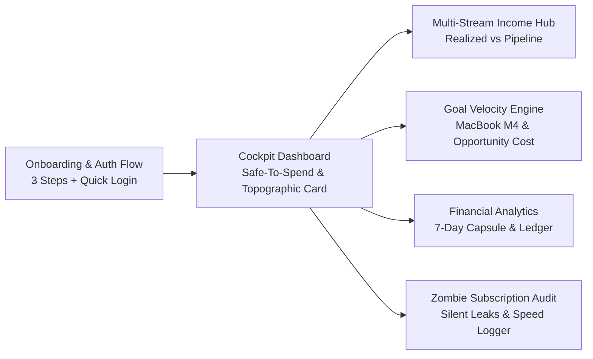

# Features & Functional Specification

## 1. Module Overview & User Flow

PulseFinance delivers a cohesive suite of financial control modules built specifically around the challenges of irregular income earners and modern digital professionals.

---

## 2. Onboarding Journey & Authentication

### 2.1. Step 1: Persona Foundation (`OnboardingStep1.kt`)
- **Objective**: Establish the user's primary monthly financial parameters without intimidating spreadsheets.
- **Components**:
  - Hero welcoming illustration with animated neon pulse.
  - Interactive Base Salary slider (LKR 80,000 to LKR 300,000 range) with live formatted value readout.
  - Primary Bank selector (Commercial Bank, Sampath Bank, HNB, Nations Trust).

### 2.2. Step 2: Income Streams Configuration (`OnboardingStep2.kt`)
- **Objective**: Capture irregular and foreign-denominated income channels.
- **Components**:
  - Stream toggle chips: **Full-Time Tech Role**, **Freelance Client Invoicing**, **AdSense & Content**, **Web3 / Crypto Yield**.
  - Multi-currency input toggles (LKR, USD, USDT) with automated real-time exchange rates.
  - Estimated variance range selector (Low / Moderate / Highly Volatile).

### 2.3. Step 3: Fixed Commitments & Safety Margin (`OnboardingStep3.kt`)
- **Objective**: Define inescapable monthly obligations to establish the true Safe-to-Spend floor.
- **Components**:
  - Quick-preset obligations (Apartment Rent: LKR 34,000, Fiber Broadband: LKR 4,800, Health Insurance: LKR 7,500).
  - Emergency Runway buffer configuration (1 to 6 months of living expenses).
  - Trajectory Preview: Real-time projection displaying estimated monthly surplus available for goal allocation.

### 2.4. Authentication Screen & Quick Credential Drawer (`AuthScreen.kt`)
- **Firebase Auth Integration**: Secure email and password authentication with encrypted token persistence.
- **Examiner Demo Drawer**: Built-in test credential auto-filler for instant grading and evaluation:
  - **Email**: `kavindu.silva@pulsemail.io`
  - **Password**: `ColomboDev2026!`
  - One-tap "Fill Kavindu's Persona" button for frictionless testing.

---

## 3. Cockpit Dashboard (`DashboardScreen.kt`)

The central mission control for daily financial decision-making.

### 3.1. Topographic Titanium Debit Card & Account Security
- **Visual Design**: Sleek dark navy/slate gradient with gold EMV chip geometry and contour wireframes.
- **Dynamic Balance**: Displays aggregated net liquidity across all connected accounts.
- **Spending Freeze (FR-ACC-3)**: One-tap toggle to freeze an account for 14 days. Any attempt to spend from a frozen account calculates the exact delay in achieving the primary savings goal and prompts confirmation (FR-ACC-4). Broken freeze count is persistently tracked (FR-ACC-5).
- **Biometric Account Number Reveal (FR-ACC-6)**: Account numbers are masked (`•••• 1234`). Tapping the reveal icon triggers Android `BiometricPrompt` (fingerprint or device PIN/pattern).
- **Secure Clipboard Auto-Wipe (FR-ACC-7)**: Sensitive account numbers copied to the clipboard are automatically wiped after 60 seconds with live notification. Per PCI-DSS / C-13 constraints, CVV numbers are never stored, transmitted, or displayed.

### 3.2. Live Safe-To-Spend Arc Gauge (`SafeToSpendGauge.kt`)
- Solves Kavindu's most acute problem: *“Can I afford this without compromising rent?”*
- Formula:
  $$\text{Safe-To-Spend} = \frac{\text{Income Basis} - \text{Committed Fixed Rent \& Bills} - \text{Goal Allocation} - \text{Discretionary Spent}}{\text{Days Remaining in Month}}$$
- Visual Arc: Dynamically transitions from Electric Green (Healthy $>60\%$) to Amber Warning ($25\% - 60\%$) to Danger Red ($<25\%$).

### 3.3. Sri Lankan Seasonal Peak Warning (FR-LK-4, FR-LK-5)
- Automatically checks for upcoming Sri Lankan seasonal expense surges within a 30-day window:
  - **Sinhala & Tamil New Year (Avurudu)** (April 14 — LKR 35,000 buffer)
  - **Vesak Festival** (May 15 — LKR 20,000 buffer)
  - **Poson Festival** (June 15 — LKR 15,000 buffer)
  - **December Holiday Season** (December 25 — LKR 45,000 buffer)
- Computes historical excess spending if 12+ months of history exist, or applies the calibrated cultural default to protect the user's savings goal pace.

### 3.4. CSV Data Export (FR-DATA-1)
- One-tap "Export Data (CSV)" action in the Cockpit header.
- Generates a full RFC-4180 compliant CSV including Incomes, Expenses, and Goals, and dispatches it via Android Share Sheet to any external app, email, or cloud storage.

### 3.5. Committed vs. Discretionary Split Bar (`CommittedVsDiscretionaryBar.kt`)
- Visualizes spending ratios in real time:
  - **Committed**: Non-negotiable costs (Rent LKR 34,000, WiFi LKR 4,800).
  - **Discretionary**: Variable lifestyle spending (Cafe, PickMe rides, dining out).
- Provides immediate awareness of lifestyle creep before month-end.

### 3.6. Overdue Freelance Milestone Banner
- Prominently surfaces unbilled or unpaid client invoices (e.g., *“SME E-Commerce Milestone: LKR 185,000 is 4 days overdue”*).
- One-tap "Reconcile / Mark Received" button that instantly shifts the invoice from *Pending Pipeline* to *Realized Liquid Cash*.

---

## 4. Goal Velocity Engine (`GoalScreen.kt` & `MacBookGoalCard.kt`)

Connects long-term hardware and savings targets directly to daily spending behaviors.

### 4.1. Flagship Target: Apple MacBook Pro M4
- **Target Value**: LKR 490,000.
- **Initial Baseline**: LKR 11,200 saved over 12 months (2.2% progress before PulseFinance).
- **Current Pacing**: LKR 1,330/day (~LKR 39,900/month allocation).

### 4.2. Interactive Opportunity Cost Translator
Solves the psychological disconnect between micro-purchases and macro-goals:
- **Preset Calculators**:
  - `☕ Artisan Cafe Flat White (LKR 850)` $\implies$ **0.64 Days of MacBook Funded**
  - `🚗 PickMe Premium Ride (LKR 1,450)` $\implies$ **1.09 Days of MacBook Funded**
  - `🍔 Weekend Restaurant Dining (LKR 2,500)` $\implies$ **1.88 Days of MacBook Funded**
- Real-time slider allows the user to slide any arbitrary LKR amount and immediately observe the impact on target completion date.

### 4.3. Dynamic Allocation Controller & Windfall Booster
- Interactive slider with haptic feedback adjusting monthly savings contribution between LKR 0 and LKR 100,000.
- Quick **+LKR 5,000**, **+LKR 10,000**, and **+LKR 25,000 Windfall Booster (FR-GOAL-7)** chips for instant allocation from freelance client payouts.
- **USD Reference Price (FR-GOAL-6)**: Users can store and display a USD benchmark price (e.g., `USD $1,999`) on tech hardware goals to track inflation and exchange rate drift against LKR depreciation.

---

## 5. Multi-Stream Income Hub (`IncomeScreen.kt`)

Engineered specifically for non-linear, hybrid modern tech workers.

### 5.1. Dual Progress Capsule (Realized vs. Pipeline)
- **Realized Cash**: LKR 278,500 (Clean cleared funds available in bank accounts).
- **Total Pipeline**: LKR 463,500 (Includes expected AdSense, USDT staking yield, and pending client invoices).
- Visual dual-segmented bar showing exact realization percentage ($60.1\%$).

### 5.2. Four Stream Card Variations
1. **Tech Company Monthly Salary**: LKR 140,000 (Predictable, direct bank transfer, recurring on 28th).
2. **Freelance Web Dev Milestone**: USD $600.00 $\implies$ LKR 185,000 (Overdue milestone tracking with client name & invoice receipt).
3. **YouTube & Blog AdSense**: USD $180.00 $\implies$ LKR 55,500 (Expected 21st of each month).
4. **Crypto Yield / USDT Staking**: USDT 270.00 $\implies$ LKR 83,000 (Binance Earn liquid distribution).

### 5.3. Currency Normalization & Payslip Engine
- Automatically fetches and normalizes foreign currencies to LKR while storing and displaying the original foreign denomination.
- **Sri Lanka APIT & EPF/ETF Calculator**: Includes progressive tax bands (6% to 36%), 8% Employee EPF, 12% Employer EPF, and 3% Employer ETF with net take-home pay breakdown.

---

## 6. Zombie Subscription Audit & Intelligent Detection (`ExpenseScreen.kt`)

Eliminates silent wealth erosion from forgotten recurring debits.

### 6.1. Multi-Account Leak Scanner & Grouping (FR-SUB-6)
Scans across all accounts and explicitly groups debits by payment account:
- Commercial Bank Primary Checking
- Secondary Bank Account (specifically flagged as auto-debit source per FR-SUB-6)
- Cash Physical Wallet
- Binance Web3 Custody

### 6.2. Risk Classification & Usage Verification (FR-SUB-4, FR-SUB-5)
- **High Risk (Red)**: Still charging after cancellation, 2+ consecutive unused months, or 30+ days since the mobile app was opened.
- **Medium Risk (Amber)**: 1 unused month, 14–29 days inactive, or unreviewed recurring charge.
- **Low Risk (Green)**: Verified active monthly utility.
- **Monthly Usage Verification Prompts (FR-SUB-4)**: Users are prompted *"Did you use this this month? [Yes 👍] [No 👎]"*, updating consecutive unused streaks and surfacing leak warnings.
- **Android App Usage Stats (FR-SUB-5)**: Leverages `UsageStatsManager` / `PACKAGE_USAGE_STATS` to automatically inspect when apps like Netflix or Spotify were last launched.

### 6.3. Annual Drag & One-Tap Nuke
- Prominent header banner calculating total annual leakage: **LKR 176,400 / year**.
- **One-Tap "Nuke" Action**: Instantly marks the subscription cancelled, logs savings to the goal velocity engine, and triggers celebratory visual feedback.

### 6.4. Bank SMS Parsing & 3-Tap Speed Expense Logger (`BankSmsParser.kt`)
- **Native Bank SMS Parser (FR-EXP-2)**: Automatically parses transaction SMS messages from Commercial Bank, Sampath Bank, and Hatton National Bank (HNB) without reading user SMS directly (uses clipboard / share-sheet intent).
- Fast-entry modal with 1-tap Sri Lankan tech presets:
  - `☕ Cafe LKR 850`
  - `🚗 PickMe LKR 1,450`
  - `🍔 UberEats LKR 2,400`
  - `🏠 Rent LKR 34,000`
- Zero friction logging: Opens, logs, and closes in under 3 seconds.

---

## 7. Financial Analytics & Clarity (`AnalyticsScreen.kt`)

### 7.1. Time Interval Engine
Switchable time windows: **Day**, **Week**, **Month**, **Year** with instant data recalculation.

### 7.2. 7-Day Capsule Bar Chart
- High-contrast vertical capsule bars rendered with rounded caps.
- Weekend vs. weekday pattern detection.
- **Peak Spending Popover**: Floating glassmorphic tooltip highlighting anomalous spend days (e.g., *“Peak: LKR 18,200 — Tech Gadgets & Dinner”*).

### 7.3. Category Distribution Donut
- Categorical breakdown of monthly outlays:
  - Housing & Rent: $42\%$
  - Food & Cafe Dining: $26\%$
  - Transport & PickMe: $14\%$
  - Cloud & Software: $18\%$

### 7.4. Interactive Transaction Ledger
- Searchable by vendor, keyword, and category.
- Filter chips for instant filtering by Account, Category, or Date.
- Tapping any transaction opens a detailed receipt breakdown.
