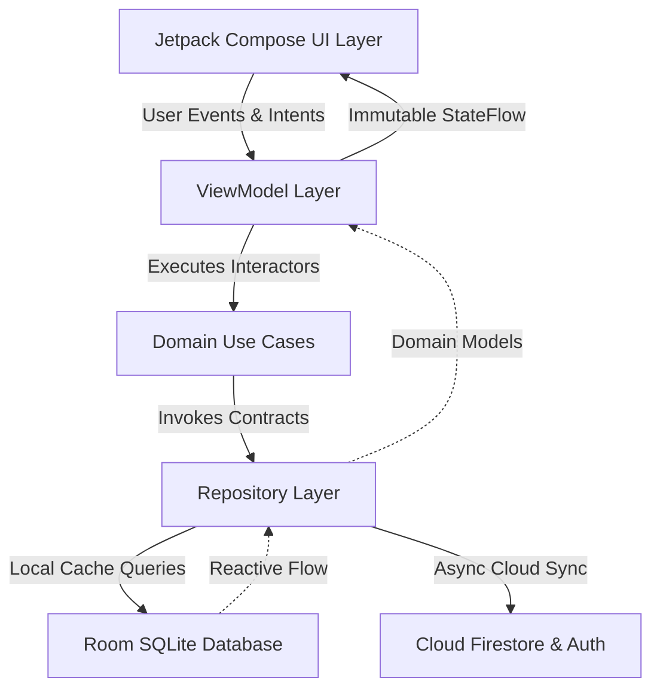

# PulseFinance — Comprehensive Master Project Documentation

**Application Name:** PulseFinance  
**Platform:** Native Android (Kotlin, Jetpack Compose, Material 3)  
**Target API:** Minimum SDK 26 (Android 8.0 Oreo) · Target SDK 34 (Android 14)  
**Academic Module:** SE3092: Platform Based Development (2026)  
**Target Persona:** Kavindu Silva (25, Junior Software Engineer, Colombo, Sri Lanka)  
**GitHub Repository:** `Hesara2003/PulseFinance` (Private)

---

## Table of Contents

1. [Executive Summary & Problem Statement](#1-executive-summary--problem-statement)
2. [Target Persona & Scenario Traceability Matrix](#2-target-persona--scenario-traceability-matrix)
3. [System Architecture & Engineering Design](#3-system-architecture--engineering-design)
4. [Vivid Neo-Fintech Design System](#4-vivid-neo-fintech-design-system)
5. [Feature Specifications & Screen Details](#5-feature-specifications--screen-details)
   - [5.1. 3-Step Onboarding & Authentication](#51-3-step-onboarding--authentication)
   - [5.2. Cockpit Dashboard](#52-cockpit-dashboard)
   - [5.3. Goal Velocity Engine & Opportunity Cost Translator](#53-goal-velocity-engine--opportunity-cost-translator)
   - [5.4. Multi-Stream Income Hub](#54-multi-stream-income-hub)
   - [5.5. Zombie Subscription Audit & Speed Logger](#55-zombie-subscription-audit--speed-logger)
   - [5.6. Financial Analytics & Clarity](#56-financial-analytics--clarity)
6. [Data Models, Schemas & Storage](#6-data-models-schemas--storage)
7. [Security Architecture & Firestore Rules](#7-security-architecture--firestore-rules)
8. [Setup, Build & Evaluation Guide](#8-setup-build--evaluation-guide)

---

## 1. Executive Summary & Problem Statement

PulseFinance is an enterprise-grade personal finance management application engineered specifically to solve the non-linear financial realities of modern digital workers, software engineers, and gig economy freelancers.

Traditional budgeting tools fail because they assume:
- A predictable, single monthly pay-check arriving on the 1st.
- Single-currency debit card transactions.
- Zero friction for manual tabular data entry.

**PulseFinance completely rethinks personal finance:**
- **Irregular Multi-Stream Normalization**: Handles fixed local salaries alongside foreign client milestones ($USD) and Web3 staking yields (USDT), separating *Realized Liquid Cash* from *Pipeline Invoices*.
- **Goal Velocity Engine**: Replaces passive wishlists with real-time daily burn and pacing equations for high-value targets (such as an Apple MacBook Pro M4).
- **Opportunity Cost Translator**: Dynamically calculates the impact of discretionary spending on life goals (e.g. *“Skipping an LKR 2,500 cafe dining out advances your MacBook goal by 1.88 days”*).
- **Zombie Subscription Hunter**: Audits multiple cards and secondary accounts to expose and eliminate forgotten recurring debits with a single tap.

---

## 2. Target Persona & Scenario Traceability Matrix

### 2.1. Persona Profile: Kavindu Silva
- **Age & Location**: 25 years old, Colombo, Sri Lanka.
- **Occupation**: Junior Software Engineer at a mid-sized IT consulting firm; freelance full-stack developer on nights and weekends.
- **Financial Streams**:
  - Full-time salary: LKR 120,000 – 140,000 / month.
  - Freelance web milestones: $400 – $800 USD / project.
  - YouTube dev tutorials & blog AdSense: $100 – $200 USD / month.
  - Crypto staking: Small yield in USDT on Binance.
- **Fixed Obligations**: Apartment rent in Colombo (LKR 34,000/mo), high-speed fiber broadband (LKR 4,800/mo).
- **Primary Goal**: Save LKR 490,000 to purchase an Apple MacBook Pro M4 for mobile development work.

### 2.2. Scenario Traceability Matrix

| Kavindu's Real-World Pain Point | Root Cause in Past Tools | PulseFinance Solution |
| :--- | :--- | :--- |
| **Irregular Cash Inflows** | Spreadsheets assume uniform monthly cash flow; formulas break on irregular date insertions. | **Multi-Stream Income Hub**: Distinctly classifies *Realized Liquid Cash* vs *Pending Pipeline Milestones*. Automatically normalizes USD/USDT to LKR at current rates. |
| **Forgotten Client Invoices** | Past apps only track money already in the bank; unbilled or unpaid work vanishes from memory. | **Overdue Invoice Engine & Alert Banner**: Detects uncollected milestones and surfaces a persistent banner on the Cockpit with a 1-tap reconcile action. |
| **Lifestyle Inflation & Dining Leaks** | Spent LKR 24k on coffee & dining; bank statements lumped everything into vague merchant categories. | **Committed vs. Discretionary Split**: Separates committed baseline rent from discretionary leaks. Features a 3-tap quick logger with Sri Lankan tech worker presets. |
| **Silent Subscription Drain** | Forgotten gym membership and cloud server auto-debited invisibly from a secondary bank account. | **Zombie Subscription Audit**: Aggregates multi-bank accounts, risk-scores recurring debits, displays annual financial drag, and offers a 1-tap "Nuke" button. |
| **Stagnated MacBook Pro Goal** | Saved only LKR 11,200 in 12 months; target was emotionally desired but financially detached from daily spending. | **Goal Velocity Engine & Opportunity Cost Translator**: Computes exact required pacing (LKR 1,330/day) and translates daily cafe/PickMe expenses directly into goal days funded. |

---

## 3. System Architecture & Engineering Design

### 3.1. Architectural Pattern: Clean Architecture + MVVM + UDF
The application follows Google's recommended architecture with strict unidirectional data flow:



### 3.2. Offline-First Architecture
1. **Room Database as Single Source of Truth**: All screen queries observe local Room SQLite tables via Kotlin `Flow<T>`.
2. **Instant Local Feedback**: Writes to database occur on the local SQLite engine first, emitting immediate state updates (0ms UI lag).
3. **Background Cloud Sync**: Asynchronous synchronization with Cloud Firestore executes in the background. If the user is offline, changes remain safely staged locally and auto-sync upon reconnection.

### 3.3. Dependency Injection (Hilt)
- **`DatabaseModule`**: Injects `AppDatabase`, `AccountDao`, `ExpenseDao`, `IncomeDao`, and `GoalDao`.
- **`FirebaseModule`**: Injects `FirebaseAuth`, `FirebaseFirestore`, and corresponding data sources.
- **`RepositoryModule`**: Binds clean domain interfaces to concrete repository implementations.

---

## 4. Vivid Neo-Fintech Design System

PulseFinance implements a custom design language crafted to deliver a modern, high-contrast, cyber-luxury experience:

### 4.1. Core Color Tokens
- **`PrimaryBlue` (`#135BFB`)**: High-energy electric blue for primary CTA buttons and active navigation states.
- **`ElectricCyan` (`#00E5FF`)**: Neon cyan accent for goal velocity glow and progress indicators.
- **`EmeraldGreen` (`#10B981`)**: Mint emerald for positive cash flow, realized income, and healthy Safe-to-Spend zones.
- **`WarningAmber` (`#F59E0B`)**: Amber caution for overdue freelance invoices and medium subscription risks.
- **`DangerRed` (`#EF4444`)**: High-contrast crimson for high-risk zombie subscriptions and 1-tap nuke triggers.
- **`BackgroundDark` (`#080C14`) & `SurfaceDark` (`#0D1117`)**: Deep obsidian surfaces designed for OLED battery conservation and high visual contrast.

### 4.2. Typography Hierarchy
- Built on **Plus Jakarta Sans** and **Inter** with clear weight gradations:
  - **Display 36sp (800 ExtraBold)**: Balances & net worth.
  - **Headline 22sp (700 Bold)**: Screen headers.
  - **Title 16sp (600 SemiBold)**: Stream and expense item names.
  - **Body 15sp (500 Medium)**: Descriptive narrative copy.
  - **Label 11sp (700 Bold)**: Pill tags and status chips.

### 4.3. Tactile Components
- **Topographic Card**: Metallic shimmer with physical gold EMV chip and laser-engraved typography.
- **Safe-To-Spend Arc**: Canvas sweep gradient arc dynamically tracking remaining liquid daily allowance.
- **Capsule Geometry**: Soft pill-shaped buttons with minimum 48dp touch targets and spring micro-interactions.

---

## 5. Feature Specifications & Screen Details

### 5.1. 3-Step Onboarding & Authentication
1. **Step 1 (Persona Foundation)**: Configures base salary (LKR 80k–300k slider) and primary banking institution.
2. **Step 2 (Income Streams Setup)**: Multi-stream selector for salary, freelance client invoices, AdSense, and crypto yields.
3. **Step 3 (Fixed Commitments & Buffer)**: Pre-fills essential expenses (Rent LKR 34k, WiFi LKR 4.8k) and configures emergency runway.
4. **Auth & Examiner Drawer**: Firebase Auth login with 1-tap demo credential auto-filler (`kavindu.silva@pulsemail.io` / `ColomboDev2026!`).

### 5.2. Cockpit Dashboard
- **Topographic Titanium Card**: Unified liquidity across Commercial Bank, Secondary Savings, Cash, and Binance.
- **Safe-To-Spend Gauge**: Live calculated allowance preventing inadvertent spending into rent obligations.
- **Committed vs. Discretionary Split**: Instant visual diagnostic comparing fixed bills against lifestyle variable outlays.
- **Overdue Freelance Milestone Banner**: Persistent alert tracking unpaid client work with 1-tap reconciliation.

### 5.3. Goal Velocity Engine & Opportunity Cost Translator
- **Flagship Target**: Apple MacBook Pro M4 (Target LKR 490,000; Saved LKR 11,200).
- **Daily Pacing Engine**: Evaluates current daily trajectory (~LKR 1,330/day) and projected completion date.
- **Opportunity Cost Translator**: Interactive converter translating daily spending choices directly into funded goal time:
  - `☕ Artisan Cafe Flat White (LKR 850)` $\implies$ **0.64 Days Funded**
  - `🚗 PickMe Ride (LKR 1,450)` $\implies$ **1.09 Days Funded**
  - `🍔 Restaurant Dinner (LKR 2,500)` $\implies$ **1.88 Days Funded**
- **Allocation Slider**: Real-time slider (LKR 0 to 100,000/mo) with instant completion date recalculation.

### 5.4. Multi-Stream Income Hub
- **Dual-Progress Capsule**: Realized Cleared Cash (LKR 278,500) vs Total Pipeline (LKR 463,500).
- **4 Real-World Stream Cards**:
  1. *Full-Time Tech Salary*: LKR 140,000 (Monthly direct deposit).
  2. *SME Client Web Milestone*: $600 USD (LKR 185,000) — Overdue invoice tracking.
  3. *YouTube / Blog AdSense*: $180 USD (LKR 55,500) — 21st monthly payout.
  4. *Crypto USDT Staking*: 270 USDT (LKR 83,000) — Binance liquid yield.
- **Currency Normalization**: Automatic real-time translation of foreign denominations to LKR.

### 5.5. Zombie Subscription Audit & Speed Logger
- **Multi-Account Aggregation**: Detects auto-debits across primary, secondary, and crypto accounts.
- **Risk-Graded Subscriptions**:
  - *High Risk*: Gym membership (LKR 8,500/mo; 68 days unused on secondary account).
  - *Medium Risk*: Abandoned dev cloud VPS (LKR 6,200/mo).
  - *Low Risk*: Spotify and Netflix.
- **Annual Drag Counter**: Highlights LKR 176,400 wasted annually.
- **One-Tap Nuke**: Instant cancellation with celebratory visual feedback.
- **3-Tap Speed Logger**: Quick expense bottom sheet with Colombo presets (`PickMe`, `Cafe`, `UberEats`, `Rent`).

### 5.6. Financial Analytics & Clarity
- **Interval Selector**: Day, Week, Month, and Year views.
- **7-Day Capsule Bar Chart**: High-contrast vertical bars with dynamic peak-spending callout popover note.
- **Category Donut Breakdown**: Rent (42%), Food & Cafe (26%), Transport (14%), Cloud/Tech (18%).
- **Searchable Transaction Ledger**: Instant filtering by account, category, and date range.

---

## 6. Data Models, Schemas & Storage

### 6.1. Room Database Entities
- **`AccountEntity`**: Tracks financial institutions, balances, and currencies.
- **`ExpenseEntity`**: Stores transaction amounts, categories, commitment classifications, and subscription risk metrics.
- **`IncomeEntity`**: Records income channels, foreign currencies, normalized LKR values, and invoice settlement statuses.
- **`GoalEntity`**: Manages savings targets, accrued amounts, monthly allocations, and flagship flags.

### 6.2. Firestore NoSQL Collections
Data is organized under secure, user-partitioned paths:
```
users/{userId}/accounts/{accountId}
users/{userId}/expenses/{expenseId}
users/{userId}/income_streams/{incomeId}
users/{userId}/goals/{goalId}
```

---

## 7. Security Architecture & Firestore Rules

- **Zero Anonymous Access**: All reads and writes require authenticated Firebase tokens.
- **Strict User Partitioning**: Enforced via Firestore Security Rules where `request.auth.uid == userId`.
- **Sandbox Isolation**: Room SQLite database stored in protected Android application internal storage.

---

## 8. Setup, Build & Evaluation Guide

### 8.1. Prerequisites
- **JDK 21** (or JDK 17) configured in `JAVA_HOME`.
- **Android Studio Ladybug (2024.2+)** or newer.
- **Android SDK Platforms 26 through 34**.

### 8.2. Build Commands
```bash
# Clean project
./gradlew clean

# Build debug APK
./gradlew assembleDebug

# Output APK path:
# app/build/outputs/apk/debug/app-debug.apk
```

### 8.3. Evaluation Persona Login
- **Email**: `kavindu.silva@pulsemail.io`
- **Password**: `ColomboDev2026!`
- *(Or tap the **"Fill Demo Persona"** pill directly on the Auth screen)*

---

*Authored for SE3092 Platform Based Development — PulseFinance Engineering Team.*
