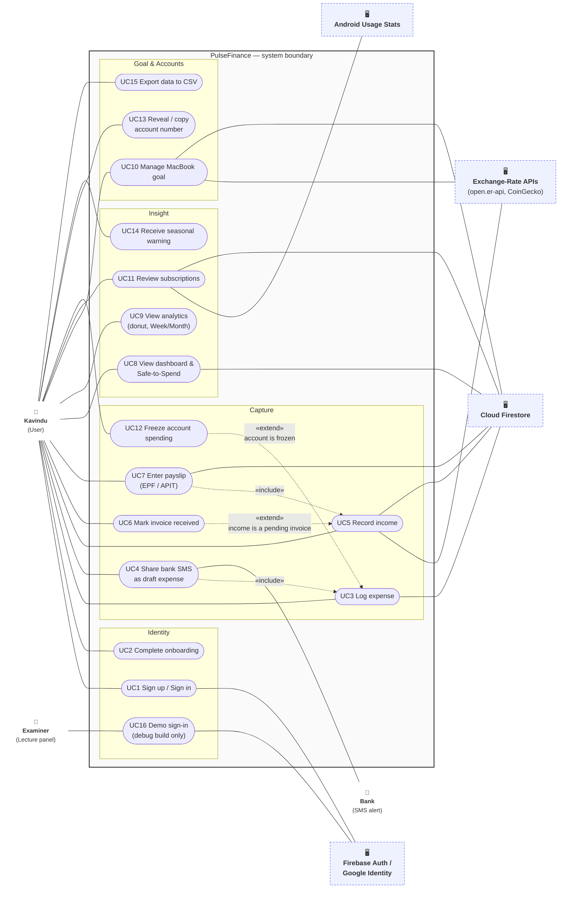

# PulseFinance — Software Requirements Specification

**Module:** SE3092 Platform Based Development — Assignment 01
**System:** PulseFinance (Android, Kotlin · Jetpack Compose · MVVM · Firebase)
**Primary user:** Kavindu Silva, 25, Junior Software Engineer, Colombo
**Vocabulary:** every capitalised domain term is defined in [`GLOSSARY.md`](../GLOSSARY.md). Architectural decisions are recorded in [`docs/adr/`](adr/).

---

## 1. Introduction

### 1.1 Purpose

This document specifies what PulseFinance must do, how well it must do it, and the limits it must work within. There was no feature list to start from. Every requirement here comes from Kavindu's scenario (assignment brief §2–§3), and each one is traced back to the paragraph it came from and the earlier failed tool it is designed to avoid.

### 1.2 Scope

PulseFinance gives one person an honest monthly picture of:

- **income** from four irregular, multi-currency sources;
- **spending** that is split by whether he had to make it or chose to;
- **progress towards one quantified goal**: a MacBook Pro M4 at about LKR 490,000, wanted within 12 months.

It does this without importing anything from a bank. Kavindu stays the source of truth, so the app is built to make recording quick, forgiving of gaps, and worth opening every day.

### 1.3 How to read the requirement tables

| Column | Meaning |
|---|---|
| **ID** | `FR-<area>-n` (functional), `NFR-n` (non-functional), `C-n` (constraint) |
| **Source** | Paragraph of the brief that produced the requirement (§3.2 = Income Problem, §3.3 = Expense Invisibility, §3.4 = Goal, §3.5 = Failed Attempts, §4.3/§5 = brief-imposed) |
| **Prevents** | Which past failure it is designed against: **F1** Google Sheet · **F2** Play Store budget app · **F3** Notes app · **F4** Bank spending summary (see §2.2) |
| **Priority** | MoSCoW: **M**ust · **S**hould · **C**ould (for the 30/10/2026 submission) |
| **Status** | **Done** = implemented in the current codebase · **Partial** = built, but with a gap listed in §10.1 · **Planned** = designed, not yet built · **Out** = deliberately excluded (see §8) |

---

## 2. Scenario Analysis

### 2.1 The problem behind the problem

Kavindu earned more than LKR 1.6 million in twelve months and has LKR 11,200 left. Lack of discipline is the obvious explanation, but it doesn't hold up: he kept the Google Sheet going diligently for thirteen days. The real problem is that **none of his tools could represent his financial life accurately enough to be worth maintaining**. When a tool's numbers stop matching reality, he stops trusting it, and once he stops trusting it, he stops using it. Each failure below is an instance of this.

### 2.2 Failure analysis of the four previous tools

| # | Tool | Proximate cause (brief §3.5) | Underlying pattern | What PulseFinance does differently |
|---|---|---|---|---|
| **F1** | Google Sheet "MacBook Fund" | Formulas broke on row insert; data entry overhead; after a 3-week gap, incomplete rows felt discouraging | **Fragile + punishing gaps.** The tool's correctness depended on Kavindu's own maintenance, and missing data looked like failure | All calculation lives in tested domain use cases, not in user-editable formulas; Logging Gaps are treated as missing data, never as zero or failure (NFR-2) |
| **F2** | Play Store budget app | USD-only; no cloud sync; assumed one income source and a fixed monthly budget | **Data model too narrow.** It could not represent four sources, three currencies, or a month whose income is unknown until the 25th | Income Source is a first-class concept; every entry keeps its original currency and the rate actually received (ADR-0001); the allowance is recalculated daily from the Income Basis, not from a fixed budget |
| **F3** | Notes app with pasted exports | Unreadable block of unlabelled figures after 4 days | **Capture without structure.** Recording was easy but produced nothing he could read back | Every record is captured *with* structure (category, committed/discretionary, account) at entry time, using presets so structure costs no extra taps |
| **F4** | Bank's native summary | Card transactions only; missed cash and secondary account; labelled a PickMe fare "online retail" | **Incomplete coverage + wrong automatic categorisation** | Accounts include cash, secondary bank and crypto wallet; the category only *suggests* committed/discretionary and Kavindu decides; shared bank SMS alerts become drafts he confirms rather than records filed automatically |

The common root cause is that the tools were **too rigid, too manual, too narrow, or too unpleasant to open**. Each of those maps to a non-functional requirement in §6: rigid → NFR-6, manual → NFR-1, narrow → FR-INC, unpleasant → NFR-2 and NFR-8.

### 2.3 Answers to the brief's analytical lenses (§4.1)

**Lens 1: What must the system understand about income structure?**
Four things, each of which a single "income" number hides:

- the **source**: salary, freelance, AdSense or crypto;
- whether the money is **realised or only invoiced**: a Pending Invoice is not spendable;
- the **original currency and the rate actually received**: AdSense is USD credited at the bank's rate, not the market rate;
- the **sign**: a crypto loss is negative income, so the Crypto YTD Net is honest.

Time matters too. Salary lands on the 25th, so a month's "income so far" is misleading until then. The system therefore bases the Safe-to-Spend Allowance on an **Income Basis**: the higher of this month's Realised Income and the three-month average. Crypto *profits* are left out of that average, so one lucky trade cannot inflate the allowance of an income-optimistic, impulsive spender (FR-DASH-3).

**Lens 2: What do the four failures share?**
See §2.2. The architectural response:

- calculation is deterministic and lives in domain use cases, never in the UI or in user formulas;
- data is cloud-synced and works offline;
- the data model is multi-source and multi-currency;
- capture uses presets, so it is structured from the first tap.

**Lens 3: How should goal progress feel real?**
Progress is expressed in Kavindu's own behaviour, not as an abstract percentage:

- the **required monthly and daily saving** to hit the deadline;
- his **actual savings rate** over the last 90 days;
- a **projected arrival date** at that rate;
- an **opportunity-cost translation**, e.g. "this LKR 850 coffee = 0.64 days of MacBook".

The goal target itself tracks the USD price, because the reseller's LKR price moves with the exchange rate (FR-GOAL-6).

**Lens 4: How should expense entry minimise friction?**
- one-tap Sri Lankan presets (PickMe, UberEats, café, Dialog/Mobitel reload);
- bank SMS alerts shared into the app become pre-filled drafts;
- every record must capture amount, category, committed/discretionary, paying account and time, because those five fields are what make the end-of-month views possible.

The target is no more than 3 taps and 5 seconds (NFR-1).

**Lens 5: The minimum views for first-week awareness.**
1. The **Committed vs Discretionary bar**, which answers "what proportion is discretionary?".
2. The **Safe-to-Spend Allowance**: one number per day.
3. The **category donut**: where the discretionary money went, which is the "LKR 24,000 on coffee" moment.
4. The **Week/Month spending chart**.

Everything else is supporting detail.

### 2.4 Problem statements

| ID | Problem (from the scenario) | Source |
|---|---|---|
| P1 | He cannot state his real monthly income; the estimate "LKR 160,000–210,000" was never validated | §3.2 |
| P2 | Freelance invoices are forgotten and payments cannot be matched to projects | §3.2 |
| P3 | AdSense USD income is never recorded at the amount actually received | §3.2 |
| P4 | He has no running net crypto position and cannot answer "YTD crypto earnings?" | §3.2 |
| P5 | Spending is spread across card, cash, PickMe, UberEats and a secondary auto-debit account, with no single view of it | §3.3 |
| P6 | Two subscriptions he meant to cancel six months ago are still being charged | §3.3 |
| P7 | He has no idea of his committed vs discretionary split and no visual of how his spending is distributed | §3.3 |
| P8 | He does not know the monthly saving needed for LKR 490,000 in 12 months, because he does not know what he currently saves | §3.4 |
| P9 | Gaps in tracking made his previous tool feel discouraging and led to abandonment | §3.4, §3.5 |
| P10 | He does not examine his payslip and cannot recall the amount deposited | §3.2 |
| P11 | He is impulsive with discretionary spending and has no friction at the point of purchase | §2 persona |

---

## 3. Stakeholders and Actors

| Actor | Type | Role |
|---|---|---|
| **Kavindu (User)** | Primary | Records income, expenses and goal; reads the dashboard and analytics; reviews subscriptions |
| **Firebase Authentication** | Secondary system | Verifies identity (email/password) and issues the user ID that partitions all data |
| **Google Identity** | Secondary system | Provides Google Sign-In credentials |
| **Cloud Firestore** | Secondary system | Primary persistence; real-time listeners push changes to the dashboard; holds APIT tax-band configuration |
| **Bank (SMS alert)** | External | Sends a transaction SMS that Kavindu shares into the app to create a draft expense. There is no direct integration |
| **Exchange-Rate Services** | External | open.er-api.com (USD→LKR) and CoinGecko (USDT/ETH→USD) provide the daily suggested rate |
| **Android Usage Stats** | Device service | Reports when subscription apps (Netflix, Spotify) were last opened, with the user's permission |
| **Lecture panel (Examiner)** | Secondary user | Signs in to a seeded demo account through the debug-only demo drawer |

---

## 4. Use Case Model

### 4.1 Use case diagram

UML notation drawn in Mermaid: actors are outside the system boundary, **primary actors on the left** and **secondary actors/systems on the right**. Use cases are ovals inside the boundary, grouped into packages. Solid lines are associations. Dashed arrows are `«include»` (always happens) and `«extend»` (happens only under a condition).

> **Exporting for the PDF:** paste the block into <https://mermaid.live> and use *Actions → PNG/SVG*. SVG stays sharp when printed.

### 4.2 Use case summary

| UC | Name | Primary actor | Trigger → outcome | Related FRs |
|---|---|---|---|---|
| UC1 | Sign up / Sign in | Kavindu | Opens app unauthenticated → signed in, data scoped to his user ID | FR-AUTH-1…3 |
| UC2 | Complete onboarding | Kavindu | First sign-in → salary, income sources, commitments and goal configured | FR-AUTH-4…6 |
| UC3 | Log expense | Kavindu | Spends money → structured expense recorded in ≤ 3 taps | FR-EXP-1…6 |
| UC4 | Share bank SMS | Kavindu, Bank | Receives card SMS → draft expense pre-filled for confirmation | FR-EXP-7 |
| UC5 | Record income | Kavindu, Rate APIs | Money arrives or is invoiced → entry with original currency and rate actually received | FR-INC-1…6 |
| UC6 | Mark invoice received | Kavindu | Client pays → Pending Invoice becomes Realised Income | FR-INC-3, 4 |
| UC7 | Enter payslip | Kavindu | Salary day → Gross, EPF, APIT and Take-Home recorded | FR-LK-1…3 |
| UC8 | View dashboard | Kavindu | Opens app → Safe-to-Spend Allowance, split bar, overdue banner, goal pace | FR-DASH-1…6 |
| UC9 | View analytics | Kavindu | Wants insight → category donut, Week/Month chart, peak day | FR-ANA-1…5 |
| UC10 | Manage goal | Kavindu | Sets or adjusts MacBook goal → required pace, projection, opportunity cost | FR-GOAL-1…7 |
| UC11 | Review subscriptions | Kavindu, Usage Stats | Subscription charged → keep/cancel decision; risk level | FR-SUB-1…6 |
| UC12 | Freeze account spending | Kavindu | Decides to stop impulsive spending → Spending Freeze with reminder | FR-ACC-3…5 |
| UC13 | Reveal / copy account number | Kavindu | Writing a freelance invoice → number revealed after biometric | FR-ACC-6, 7 |
| UC14 | Seasonal warning | Kavindu | 30 days before a Seasonal Peak → warning + set-aside suggestion | FR-LK-4, 5 |
| UC15 | Export CSV | Kavindu | Wants his data out → CSV of all records | FR-DATA-1 |
| UC16 | Demo sign-in | Examiner | Demo session → signed in to seeded real account (debug build only) | FR-AUTH-7 |

---

## 5. Functional Requirements

### 5.1 Identity and onboarding (FR-AUTH)

| ID | Requirement | Source | Prevents | Pri | Status |
|---|---|---|---|---|---|
| FR-AUTH-1 | The system shall let Kavindu register and sign in with email and password through Firebase Authentication. | §4.3, §5 | F2 (no sync) | M | Done |
| FR-AUTH-2 | The system shall let Kavindu sign in with his Google account. | §5 (bonus) | F2 | S | Done |
| FR-AUTH-3 | The system shall store every record under the signed-in user's ID, so the same data appears on any device he signs in to. | §3.5 (F2: "no cloud synchronisation") | F2 | M | Done |
| FR-AUTH-4 | Onboarding shall capture his salary, his active Income Sources (Salary, Freelance, AdSense, Crypto) and his fixed monthly commitments (e.g. rent LKR 34,000) in three short steps. | §3.2, §3.3 | F2 (single source) | M | Done |
| FR-AUTH-5 | Onboarding shall let him state each source's expected variability (low / moderate / highly volatile). | §3.2 ("different levels of predictability") | F2 | C | Done |
| FR-AUTH-6 | Onboarding shall let him set an emergency-runway buffer of 1–6 months of committed costs. | §3.1 (LKR 11,200 savings) | — | C | Done |
| FR-AUTH-8 | The system shall let Kavindu reset a forgotten password by email, and shall answer the same way whether or not the address has an account. | Audit 05/11/2026 | — | S | Planned (PR #155) |
| FR-AUTH-9 | The system shall let Kavindu delete his account: after he re-authenticates it shall erase every record stored for him, delete his sign-in and empty the on-device cache, and shall change nothing if the re-authentication fails (ADR-0002). | Audit 05/11/2026 (data ownership) | F1 | S | Planned (PR #155) |
| FR-AUTH-10 | The system shall send a verification email when an email account is created, and let him request another from the account menu; verification shall not be required to use the app. | Audit 05/11/2026 | — | C | Planned (PR #155) |
| FR-AUTH-7 | A debug-build-only demo drawer shall fill in the credentials of a real, pre-seeded Firebase account; credentials shall come from build configuration, never from source code, and the drawer shall not exist in release builds. | §6.4 (live demo), §4.3 (no hard-coded data) | — | M | Done |

### 5.2 Income (FR-INC)

| ID | Requirement | Source | Prevents | Pri | Status |
|---|---|---|---|---|---|
| FR-INC-1 | Each income entry shall record its Income Source, a title, the client or platform, the original amount, the original currency (LKR, USD, USDT, ETH) and the date received or expected. | §3.2 | F2 (USD-only, single source) | M | Done |
| FR-INC-2 | Each entry shall store the exchange rate used, and that rate shall never be recomputed after saving, so past months always reconcile with the bank (ADR-0001). | §3.2 ("at the prevailing rate at the time of transfer") | F1, F2 | M | Done |
| FR-INC-3 | Freelance income shall be recordable as a Pending Invoice with a client name and due date, and marked received in one tap when paid. | §3.2 ("twice forgotten to follow up") | — | M | Done |
| FR-INC-4 | A Pending Invoice whose due date has passed shall automatically be treated as an Overdue Invoice, without manual relabelling. | §3.2 | — | M | Done |
| FR-INC-5 | The income form shall pre-fill the day's suggested rate fetched from open.er-api.com (USD→LKR) and CoinGecko (USDT/ETH→USD), cached once per day and usable offline with its age shown. | §3.2 | F1 (manual lookup) | M | Done |
| FR-INC-6 | For a foreign-currency entry, Kavindu shall be able to type the LKR amount his bank actually credited instead of a rate; the system shall derive and store the effective rate. | §3.2 (AdSense "never records what he actually receives") | F1 | M | Done |
| FR-INC-7 | A crypto trade shall be recorded as a Crypto Trading Result: positive for a profit, negative for a loss. | §3.2 ("significant gain in Q1 and a material loss in Q3") | — | M | Done |
| FR-INC-8 | The system shall show the Crypto YTD Net figure. | §3.2 ("cannot answer" YTD crypto earnings) | — | M | Done |
| FR-INC-9 | The Income screen shall show Realised Income and pending/overdue amounts separately for the month, by source. | §3.2 ("opens four separate applications") | F2 | M | Done |
| FR-INC-10 | Kavindu shall be able to correct a recorded income entry. Editing shall keep the entry's stored rate and date unless he changes them (ADR-0001). | Audit 05/11/2026 (mistakes shouldn't need delete-and-retype) | F1 | S | Done |
| FR-INC-11 | Monthly rupee income not yet recorded this month shall be offered as a one-tap "Add this month's …" suggestion; nothing shall be added without his tap, and foreign-currency entries shall not be suggested because the rate received can't be assumed. | §3.2 (recurring salary), §3.5 (low friction) | F1 | C | Done |

### 5.3 Expenses (FR-EXP)

| ID | Requirement | Source | Prevents | Pri | Status |
|---|---|---|---|---|---|
| FR-EXP-1 | Each expense shall record amount (LKR), category, committed/discretionary flag, paying account, timestamp and optional note. | §4.1 lens 4 | F3 (unlabelled figures) | M | Done |
| FR-EXP-2 | The category shall propose committed or discretionary (e.g. Rent → Committed, Food & Dining → Discretionary); Kavindu may flip it per expense in one tap. | §3.3 ("no concept of… discretionary versus committed") | F4 (miscategorisation) | M | Done |
| FR-EXP-3 | The add-expense sheet shall offer one-tap Sri Lankan presets (café, PickMe, UberEats, rent). | §3.3, §3.5 ("low tolerance for friction") | F1, F3 | M | Done |
| FR-EXP-4 | Presets shall include Dialog and Mobitel mobile reloads and data packages. | Sri Lankan context (prepaid micro-spend) | F3 | S | Done |
| FR-EXP-5 | Expenses shall be attributable to any of his accounts, including Cash and the secondary auto-debit account. | §3.3 ("cash withdrawals… secondary account") | F4 (card-only coverage) | M | Done |
| FR-EXP-6 | An expense saved while offline shall appear immediately and sync when the connection returns. | §5 (offline persistence) | F2 | M | Done |
| FR-EXP-8 | Kavindu shall be able to correct a logged expense's amount, title, category, date and account from the Dashboard and the Analytics ledger. It shall not be possible to move an expense onto a frozen account this way (FR-ACC-4). | Audit 05/11/2026 | F1 | S | Done |
| FR-EXP-7 | Kavindu shall be able to share a bank transaction SMS into PulseFinance through Android's share sheet; the system shall parse amount, merchant and card last-four digits into a draft expense for one-tap confirmation, without the READ_SMS permission. | §3.3, §4.1 lens 4 | F3, F4 | S | Done |

### 5.4 Subscriptions (FR-SUB)

| ID | Requirement | Source | Prevents | Pri | Status |
|---|---|---|---|---|---|
| FR-SUB-1 | The system shall detect recurring subscriptions by grouping subscription-category expenses by merchant over the last 120 days. | §3.3 ("two subscription services he intended to cancel") | F4 | M | Done |
| FR-SUB-2 | Each detected subscription shall show its monthly and annual cost and the account it is charged to. | §3.3 | F4 | M | Done |
| FR-SUB-3 | Kavindu shall record a Keep or Cancel decision per subscription; a charge logged after a Cancel shall flag it as "still charging". | §3.3 ("intended to cancel six months ago") | — | M | Done |
| FR-SUB-4 | When a subscription charge is logged, the system shall ask "Did you use this this month? Yes / No"; two consecutive "No" answers shall set its Subscription Risk to High and prompt cancellation. | §3.3 (gym auto-debit) | — | S | Done |
| FR-SUB-5 | For subscriptions tied to an app (Netflix, Spotify), the system shall, with the user's permission, use Android usage statistics to show the last time that app was opened and factor it into Subscription Risk. | §3.3 | — | S | Done |
| FR-SUB-6 | The subscription scan shall group results by recorded account and highlight subscriptions charged to the secondary account. | §3.3 ("auto-debited from a secondary account") | F4 | S | Done |

### 5.5 Savings goal (FR-GOAL)

| ID | Requirement | Source | Prevents | Pri | Status |
|---|---|---|---|---|---|
| FR-GOAL-1 | Kavindu shall be able to set a goal with a title, LKR target and target date (default: MacBook Pro M4, LKR 490,000, 12 months). | §3.4 | F1 | M | Done |
| FR-GOAL-2 | The system shall calculate the required monthly and daily saving to reach the goal by its date. | §3.4 ("does not know what monthly savings rate is required") | F1 | M | Done |
| FR-GOAL-3 | The system shall calculate his actual savings rate (realised income − spending, averaged over the last 90 days or since his first record). | §3.4 ("does not know what he currently saves") | F1 | M | Done |
| FR-GOAL-4 | The system shall project the arrival date at the actual savings rate and state whether he is on pace or behind, by how much. | §3.4 ("emotionally present and financially invisible") | F1 | M | Done |
| FR-GOAL-5 | The system shall translate any amount into "days of MacBook funded" (opportunity cost), with presets for common Sri Lankan purchases. | §3.4, §2 ("impulsive") | — | S | Done |
| FR-GOAL-6 | The goal shall optionally store a USD reference price; its LKR target shall follow the daily exchange rate, and the change shall be shown to him. | §3.4 (priced "from an authorised reseller"; LKR prices track USD) | F2 | S | Done |
| FR-GOAL-7 | Quick-add boosters (+LKR 5,000 / 10,000 / 25,000) shall let him move a windfall (e.g. a freelance milestone) into the goal. | §3.2 (milestone payments) | — | C | Done |

### 5.6 Dashboard (FR-DASH)

| ID | Requirement | Source | Prevents | Pri | Status |
|---|---|---|---|---|---|
| FR-DASH-1 | The dashboard shall show the Safe-to-Spend Allowance per day for the rest of the month: (Income Basis − Committed − goal saving − discretionary so far) ÷ days remaining. | §3.3, §3.4 | F2 (fixed monthly budget) | M | Done |
| FR-DASH-2 | Pending and overdue invoices shall never be counted as spendable. | §3.2 | — | M | Done |
| FR-DASH-3 | The three-month average in the Income Basis shall leave out crypto profits but keep crypto losses. | §2 ("optimistic about income"), §3.2 | — | M | Done |
| FR-DASH-4 | The dashboard shall show the month's Committed vs Discretionary split as a bar with amounts. | §3.3 ("no concept of what proportion") | F4 | M | Done |
| FR-DASH-5 | The dashboard shall show an Overdue Invoice banner with client and amount, with one-tap "mark received". | §3.2 ("forgotten to follow up") | — | M | Done |
| FR-DASH-6 | Dashboard figures shall update in real time from Firestore listeners. | §5 ("Real-time listeners on dashboard") | F2 | M | Done |

### 5.7 Analytics (FR-ANA)

| ID | Requirement | Source | Prevents | Pri | Status |
|---|---|---|---|---|---|
| FR-ANA-1 | The system shall show a category donut for the selected period, discretionary categories distinguishable from committed ones. | §3.3 ("never seen a visual representation of how his spending is distributed") | F3, F4 | M | Done |
| FR-ANA-2 | Analytics shall switch between Week and Month periods. | §3.3, §4.1 lens 5 | F3 | M | Done |
| FR-ANA-3 | Analytics shall show a daily spending bar chart and highlight the peak spending day. | §3.3 ("LKR 24,000 on coffee… genuinely shocking") | F3 | S | Done |
| FR-ANA-4 | Analytics shall additionally offer Day and Year periods. | §4.1 lens 5 | — | C | Done |
| FR-ANA-5 | The transaction list shall be searchable by merchant/keyword and filterable by account, category and date. | §3.2 ("could not reconcile which payment corresponded to which project") | F3 | C | Done |

### 5.8 Accounts and Spending Freeze (FR-ACC)

| ID | Requirement | Source | Prevents | Pri | Status |
|---|---|---|---|---|---|
| FR-ACC-1 | Kavindu shall be able to record accounts of type Primary Bank, Secondary Bank (auto-debit), Cash and Crypto Exchange. | §3.3 | F4 | M | Done |
| FR-ACC-2 | The dashboard card shall show combined balance across his recorded accounts. | §3.1 ("cannot articulate where the rest went") | F4 | S | Done |
| FR-ACC-3 | Kavindu shall be able to place a Spending Freeze on an account until a chosen date; the account shall appear locked on the dashboard. | §2 ("impulsive with discretionary spending") | — | S | Done |
| FR-ACC-4 | Logging an expense against a frozen account shall show a reminder with the opportunity cost in goal-days, offering "Log anyway"; the system shall never refuse to record the expense. | §2, §3.4 | F1 (records must stay true) | S | Done |
| FR-ACC-5 | The system shall count Freeze Breaks and show them in the weekly summary. The count is a running total ("N Freeze Breaks so far"), because a break is not stored with a date. | §2 | — | S | Done (weekly line: PR #156) |
| FR-ACC-6 | Account numbers shall be displayed masked (•••• 4521) and revealed only after biometric or device-PIN authentication. | §3.2 (freelance invoicing needs bank details) | — | S | Done |
| FR-ACC-7 | A revealed account number shall be copyable for pasting into a freelance invoice; the clipboard shall be cleared after 60 seconds. | §3.2 | — | S | Done |
| FR-ACC-8 | Kavindu shall be able to add, rename, retype and delete accounts. Deleting an account shall leave the expenses logged against it, and he shall always keep at least one account. | §3.3 (Binance wallet, cash) | F4 | S | Done |
| FR-ACC-9 | Kavindu shall be able to set what each account holds, as his own record (not read from a bank); a balance may be negative, for a card he owes on. | §3.1, C-13 | F4 | S | Done |

### 5.9 Sri Lankan context (FR-LK)

| ID | Requirement | Source | Prevents | Pri | Status |
|---|---|---|---|---|---|
| FR-LK-1 | Kavindu shall be able to record a salary payslip as Gross Salary; the system shall calculate employee EPF (8%) and APIT, and show the resulting Take-Home Salary. All three values shall be editable. | §3.2 ("rarely examines his payslip… cannot recall the exact amount deposited") | F2 | M | Done |
| FR-LK-2 | APIT tax bands shall be read from configuration data in Firestore, not compiled into the app. | Sri Lankan APIT bands revised 2023 and 2025 | — | M | Done |
| FR-LK-3 | The system shall show his accumulating EPF Balance (employee 8% + employer 12%) as savings he already owns. | §3.1 ("LKR 11,200 in savings") | — | S | Done |
| FR-LK-4 | The system shall know Sri Lankan Seasonal Peaks (Avurudu – April, Vesak – May, Poson – June, December) and, after 12 months of history, add months where his own spending was ≥ 20% above average. | §2 ("impulsive"), §3.3 | — | S | Done |
| FR-LK-5 | 30 days before a Seasonal Peak, the system shall warn him with last year's excess (if known) and offer to set the amount aside. | §3.4 (goal protection) | — | S | Done |
| FR-LK-6 | All amounts shall be formatted in LKR with thousands separators; foreign amounts shall show the original currency beside the LKR equivalent. | §3.2 | F2 (USD-only) | M | Done |

### 5.10 Data ownership (FR-DATA)

| ID | Requirement | Source | Prevents | Pri | Status |
|---|---|---|---|---|---|
| FR-DATA-1 | Kavindu shall be able to export all his income, expenses and goal records to CSV. | §3.5 (four abandoned tools; data should outlive the tool) | F1, F3 | S | Done |

### 5.11 Notifications (FR-NTF)

| ID | Requirement | Source | Prevents | Pri | Status |
|---|---|---|---|---|---|
| FR-NTF-1 | When an invoice is overdue, the system shall send at most one notification a day naming the work, the amount and how late it is. Reminders shall be off until he opts in, shall be offered only once an invoice is overdue, and the Android 13 notification permission shall be requested at that moment (ADR-0003). | §3.2 ("twice forgotten to follow up") | — | C | Planned (PR #160) |

---

## 6. Non-Functional Requirements

| ID | Quality | Requirement | Measurable target | Source | Prevents | Pri | Status |
|---|---|---|---|---|---|---|---|
| NFR-1 | Usability: capture speed | Logging a preset expense from the dashboard shall be fast enough to do at the point of purchase. | ≤ 3 taps and ≤ 5 seconds | §3.5 ("low tolerance for friction in daily data entry") | F1, F3 | M | Done |
| NFR-2 | Usability: gap tolerance | Logging Gaps shall never be shown as zero spending, broken streaks or failure; averages shall be computed only over the period that has data. | No view shows a penalty, streak reset or "0 spent" for unrecorded days | §3.4 ("incomplete entries felt more discouraging than helpful") | F1 | M | Done |
| NFR-3 | Availability: offline | All screens shall work fully offline using cached data; writes made offline shall sync on reconnection. | Sync ≤ 10 s after reconnection; no screen blank or blocked by the network | §4.3, §5 | F2 | M | Done |
| NFR-4 | Responsiveness: real-time | Changes made on another device shall appear on the dashboard without a refresh. | ≤ 2 s when online | §5 | F2 | M | Done |
| NFR-5 | Security: data isolation | A user shall be able to read and write only documents under `users/{their uid}`, enforced server-side by Firestore Security Rules. | Rules deny all cross-user access in the Rules Playground | §4.3, §5 | — | M | Done |
| NFR-6 | Integrity: financial accuracy | Every income entry shall keep its original amount, currency and the rate used; totals shall be derivable from stored records alone. | Month totals identical before and after a rate-API change | §3.2, §3.5 (formulas broke) | F1, F2 | M | Done |
| NFR-7 | Compatibility and performance | The app shall install and run on Android 8.0+ and start quickly on a mid-range device. | minSdk 26, targetSdk ≥ 34; cold start ≤ 2 s | §4.3, §5 | — | M | Done |
| NFR-8 | Accessibility | Status shall never be shown by colour alone; text shall remain usable at large font sizes. | Each red/amber/green state also has an icon or label; layouts usable at 200% font scale | §3.5 ("too unpleasant to open every day") | — | S | Done |
| NFR-9 | Robustness: empty and error states | No screen shall crash or appear blank with no data, partial data or a network error. | Every screen has a designed empty state; zero unhandled exceptions in the demo run | §4.3 | F1 | M | Done |
| NFR-10 | Security: sensitive display | Account numbers shall be masked by default and revealed only after biometric/device-credential check. | Reveal requires `BiometricPrompt` success; clipboard cleared ≤ 60 s | Derived from FR-ACC-6 | — | S | Done |
| NFR-11 | Portability | Data shall be exportable in an open format. | CSV readable by Google Sheets/Excel without editing | §3.5 | F1 | S | Done |
| NFR-12 | Privacy | The app shall request the minimum permissions; optional permissions (usage access) shall be requested only when the related feature is first used, with an explanation. | No READ_SMS; usage-access requested in context only | Derived from FR-EXP-7, FR-SUB-5 | — | M | Done |

---

## 7. Constraints

### 7.1 Imposed by the brief

| ID | Constraint | Source |
|---|---|---|
| C-1 | Application code shall be 100% Kotlin; Gradle scripts in Kotlin DSL. | §4.3, §5 |
| C-2 | All UI shall be Jetpack Compose with Material Design 3; no XML layouts. | §4.3, §5 |
| C-3 | MVVM with strict UI → ViewModel → Repository → Model separation; no business logic in Composables; no data calls from the UI layer. | §4.3, §5 |
| C-4 | Single-activity architecture using Navigation Compose. | §5 |
| C-5 | State shall be exposed as StateFlow; no raw mutable state exposed from ViewModels. | §5 |
| C-6 | All asynchronous work shall use Kotlin Coroutines in `viewModelScope`. | §5 |
| C-7 | Dependency injection with Hilt; no manual ViewModel instantiation in Composables. | §5 |
| C-8 | Firebase Authentication shall manage identity; no hard-coded user data. | §4.3 |
| C-9 | Cloud Firestore shall be the primary persistence layer; `firestore.rules` shall be submitted. | §4.3 |
| C-10 | minSdk 26 (Android 8.0), targetSdk ≥ 34. | §4.3, §5 |
| C-11 | The submitted APK shall connect to a live Firebase project, not an emulator. | §6.3 |
| C-12 | The app cannot import bank data automatically. | §4.1 lens 4 |

### 7.2 Design constraints derived from the scenario

| ID | Constraint | Rationale |
|---|---|---|
| C-13 | The system has no connection to any bank; every account balance and transaction is Kavindu's own record. "Freeze" is a self-commitment, not a card block. | Follows from C-12; keeps every feature honest about what it can control. |
| C-14 | Card CVVs shall never be stored, displayed or requested. | PCI-DSS forbids storage of card verification codes after authorisation. |
| C-15 | The READ_SMS permission shall not be used; bank SMS enter only through the Android share sheet. | Google Play restricts SMS permissions; user-initiated sharing keeps Kavindu in control (C-12). |
| C-16 | Tax rules (APIT bands, EPF rates) shall be data, not code. | Sri Lankan rates change by budget; avoids a new APK for a rate change. |
| C-17 | Exchange-rate services are free, rate-limited third parties; the app shall call each at most once per day and must keep working when they are unavailable. | Free-tier limits; NFR-3 offline requirement. |
| C-18 | Demo credentials shall be injected via build configuration into debug builds only. | C-8; examiner access without hard-coded data in source or release builds. |

---

## 8. Out of Scope

| Item | Reason |
|---|---|
| Automatic bank-feed import / open banking | Excluded by the brief (C-12); no Sri Lankan open-banking API available to students. |
| Real card blocking, CVV display | No bank integration (C-13); CVV storage forbidden (C-14). |
| Crypto portfolio holdings and live valuation | Kavindu's question is realised YTD earnings (P4); live prices add daily noise and an exchange API for no clarity gain. |
| Multiple simultaneous goals with competing allocations | One quantified goal is the scenario's focus (§3.4); the model allows more goals but no allocation logic between them. |
| Shared/household budgets | Single-user persona. |
| Location-based (geofence) gym-usage detection | Battery and privacy cost out of proportion to benefit; charge-day prompt (FR-SUB-4) covers the need. |
| Sinhala/Tamil UI, "lakhs" number formatting | Considered; Kavindu works in English and reads LKR in thousands. Deferred. |
| Seettu (rotating savings group) tracking | Considered; not in Kavindu's scenario. Deferred. |

---

## 9. Traceability Matrix — Problem → Requirements

| Problem | Requirements that address it |
|---|---|
| P1 Unknown real income | FR-INC-1, FR-INC-9, FR-DASH-1, FR-LK-1 |
| P2 Forgotten invoices | FR-INC-3, FR-INC-4, FR-DASH-5, FR-ANA-5, FR-ACC-7 |
| P3 AdSense never recorded as received | FR-INC-2, FR-INC-5, FR-INC-6, NFR-6 |
| P4 No net crypto position | FR-INC-7, FR-INC-8, FR-DASH-3 |
| P5 Fragmented spending channels | FR-EXP-5, FR-EXP-7, FR-ACC-1, FR-ACC-2 |
| P6 Forgotten subscriptions | FR-SUB-1…6 |
| P7 No committed/discretionary view | FR-EXP-2, FR-DASH-4, FR-ANA-1, FR-ANA-2 |
| P8 Unknown required saving rate | FR-GOAL-2, FR-GOAL-3, FR-GOAL-4, FR-GOAL-6 |
| P9 Gaps cause abandonment | NFR-1, NFR-2, NFR-9, FR-DATA-1 |
| P10 Payslip not understood | FR-LK-1, FR-LK-2, FR-LK-3 |
| P11 Impulsive spending | FR-GOAL-5, FR-ACC-3…5, FR-LK-4, FR-LK-5, FR-DASH-3 |

### 9.1 Failure → Requirements

| Failed tool | Requirements that prevent a repeat |
|---|---|
| F1 Google Sheet | NFR-2, NFR-6, NFR-1, FR-GOAL-2…4, FR-DATA-1 |
| F2 Play Store app | FR-AUTH-3, FR-INC-1, FR-INC-2, FR-DASH-1, FR-LK-6, NFR-3, NFR-4 |
| F3 Notes app | FR-EXP-1, FR-EXP-3, FR-EXP-7, FR-ANA-1, FR-ANA-3 |
| F4 Bank summary | FR-EXP-2, FR-EXP-5, FR-ACC-1, FR-SUB-6 |

---

## 10. Priority Summary for 30/10/2026

Status as of 05/11/2026, checked against the code on `main`. A requirement marked *Planned (PR #n)* is built and in review but not yet on `main`.

| Priority | Done | Partial | Planned |
|---|---|---|---|
| **Must** | FR-AUTH-1, 3, 4, 7 · FR-INC-1–9 · FR-EXP-1–3, 5, 6 · FR-SUB-1–3 · FR-GOAL-1–4 · FR-DASH-1–6 · FR-ANA-1, 2 · FR-ACC-1 · FR-LK-1, 2, 6 · NFR-1, 2, 3–7, 9, 12 | — | — |
| **Should** | FR-AUTH-2 · FR-INC-10 · FR-EXP-4, 7, 8 · FR-SUB-4, 5, 6 · FR-GOAL-5, 6 · FR-ANA-3 · FR-ACC-2–9 · FR-LK-3–5 · FR-DATA-1 · NFR-8, 10, 11 | — | FR-AUTH-8, 9 (PR #155) |
| **Could** | FR-AUTH-5, 6 · FR-INC-11 · FR-GOAL-7 · FR-ANA-4, 5 | — | FR-AUTH-10 (PR #155) · FR-NTF-1 (PR #160) |

### 10.1 Open gaps

An earlier version of this section said there were no open gaps. A fuller audit of the app on 05/11/2026 found the following, and each has a tracking issue.

**Built and waiting for review**

- FR-AUTH-8, 9, 10 (password reset, delete account, verification email): PR #155.
- FR-NTF-1 (overdue-invoice reminder): PR #160.
- FR-ACC-5: the weekly summary now carries the Freeze Break count (PR #156). Until it merges, the count appears only on the Today screen's account section.

**Not done**

| Gap | Why it matters | Where tracked |
|---|---|---|
| About 200 user-visible strings are written into the Kotlin code, not `strings.xml` | Blocks translating the app into Sinhala or Tamil, which a Sri Lankan user base would expect | Audit finding, no requirement yet |
| Android lint reports 94 warnings on `main`: 66 are dependency versions behind the latest, and 18 are number formatting without a locale (fixed in PR #156) | No errors, and CI now fails on errors (PR #157). Upgrading the dependencies and the Android Gradle Plugin is a deliberate, separate piece of work | #149 |
| ViewModel test coverage covers Income and Dashboard only (PR for #148) | Setup, Goal and Auth ViewModels have no tests | #148 |
| NFR performance targets (NFR-1, 2) have not been measured on a device | Needs a physical phone and a stopwatch, not code; only the accessibility check is recorded so far | `docs/qa/` |
| The demo account's password is shared in the team's local configuration | Rotating it affects all three developers' setups | Audit finding |
| The Google OAuth consent screen is in testing mode (#105) and the logo author credit is missing (#109) | Only the project owner can change these in the Google console and on Flaticon | #105, #109 |
| Annotated wireframes are still to be added to the report | Deliverable for the technical report | #108 |

Firestore rules were previously only partly deployed: the live project ran a 33-line version. The validating rules in `firestore.rules` were deployed on 05/11/2026 after 18 emulator tests passed (PR #158).

---

## Appendix A — Corrections needed in `docs/`

These statements in `docs/` conflicted with this SRS. All of them were corrected on 05/11/2026, when the documents were rewritten from the code.

| Document | Statement | Correct per SRS | Status |
|---|---|---|---|
| FEATURES_SPECIFICATION §2.4 | Demo drawer lists the email and password in the text | Credentials injected by build config, debug only (FR-AUTH-7, C-18); do not publish them in docs | Fixed |
| FEATURES_SPECIFICATION §3.1 | "freeze card, reveal CVV, or copy account number" | Spending Freeze as self-commitment; reveal *account number* only; no CVV (FR-ACC-3…7, C-13, C-14) | Fixed |
| FEATURES_SPECIFICATION §5.3, DATA_MODELS §5 | Rates "automatically fetch and normalise"; fixed 308.50 / 307.40 | Fetched rate is a suggestion; received LKR decides; rate frozen per entry (ADR-0001) | Fixed |
| FEATURES_SPECIFICATION §6.1 | "Scans across all aggregated accounts" | Scans Kavindu's *recorded* accounts (FR-SUB-6, C-13) | Fixed |
| FEATURES_SPECIFICATION §6.2 | "Unused for 68 days" | Risk from charge-day answers and app usage (FR-SUB-4, 5) | Fixed |
| FEATURES_SPECIFICATION §5.2 | Crypto as "USDT staking yield" | Crypto Trading Results, profit or loss (FR-INC-7) | Fixed |
